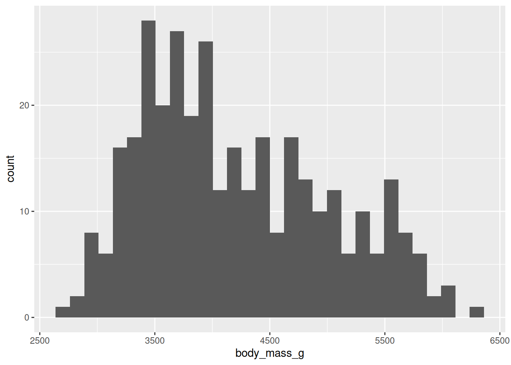
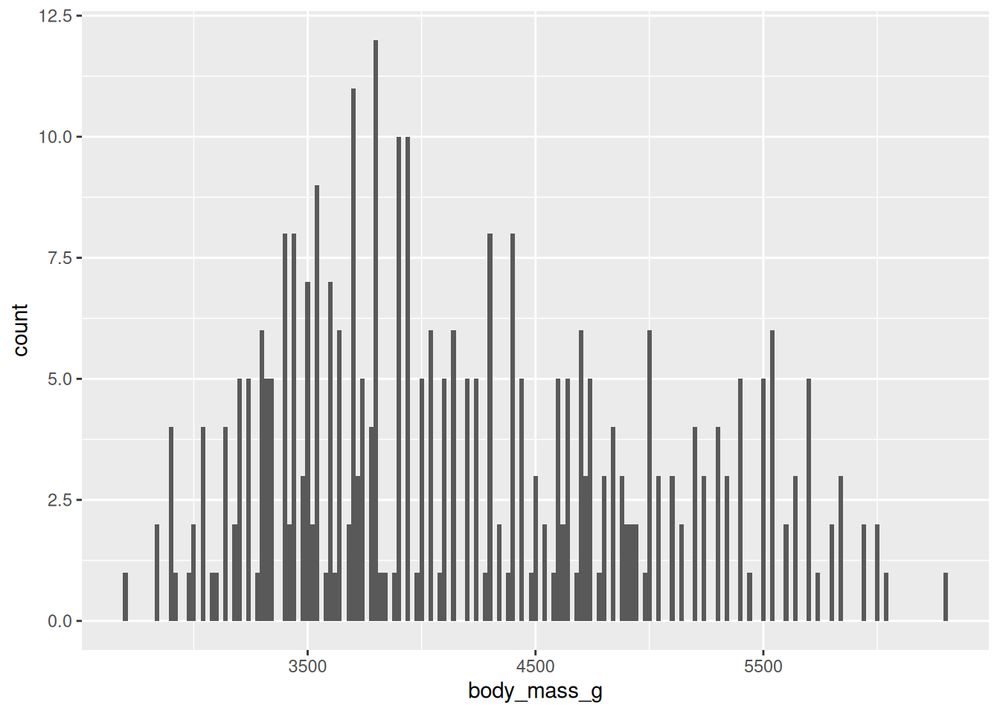
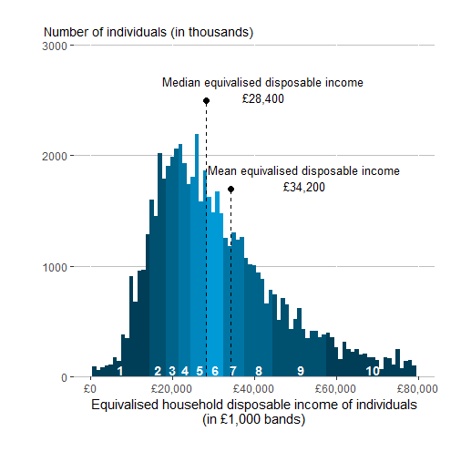
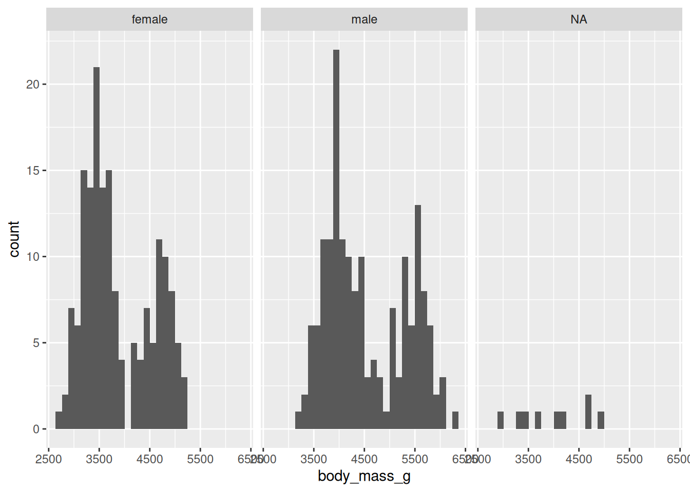
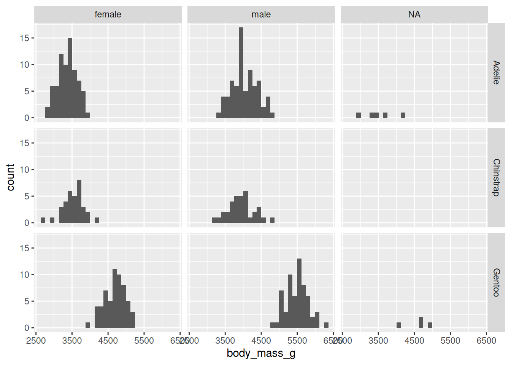
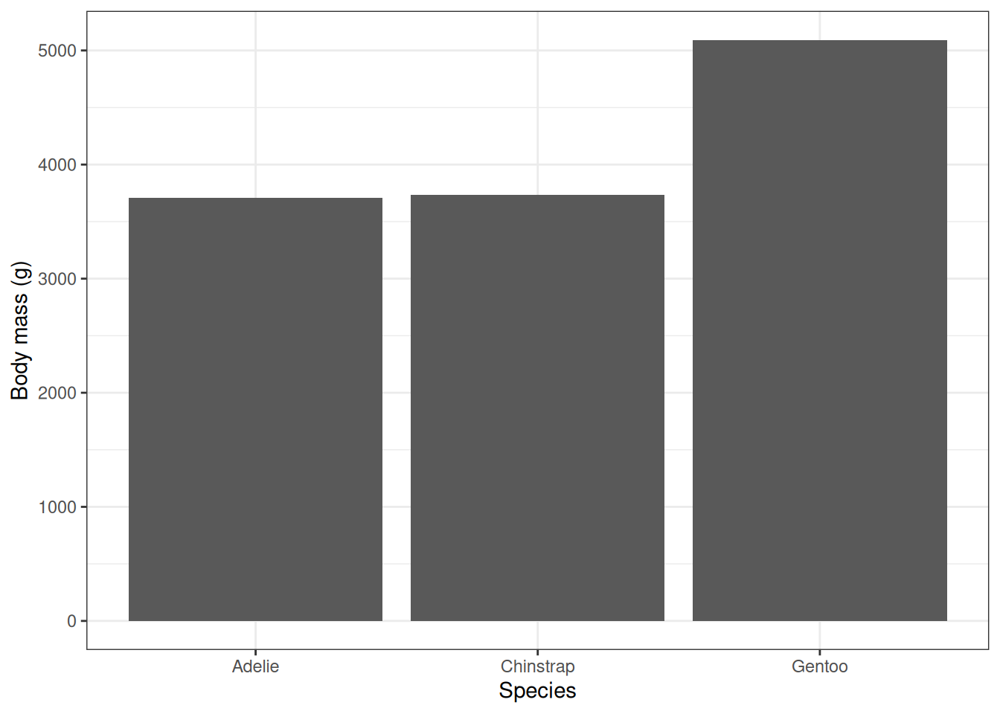
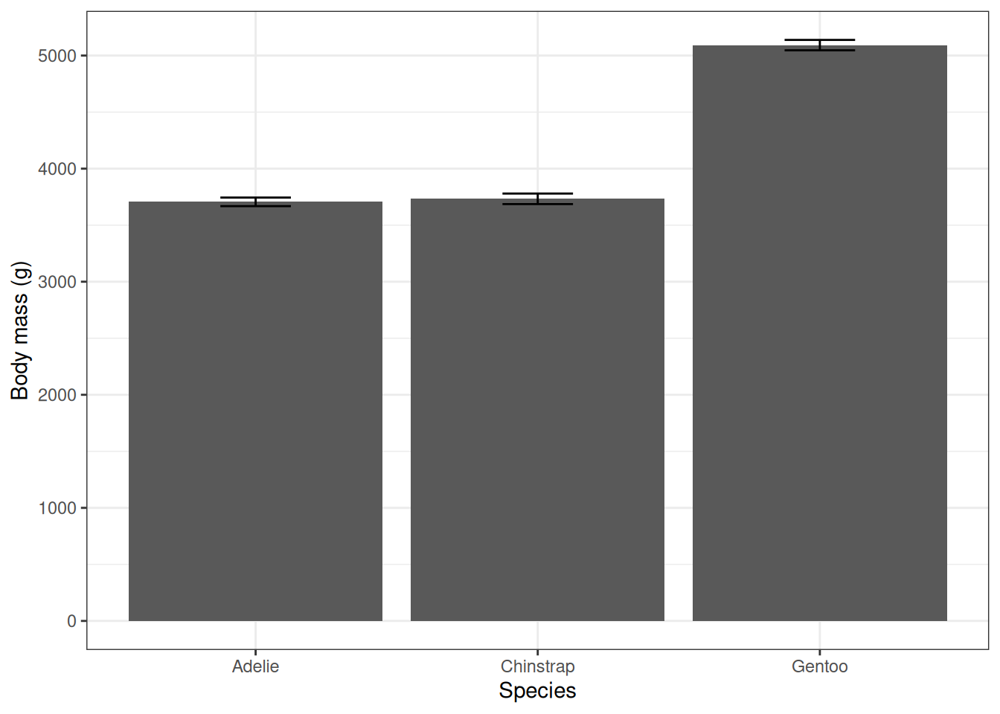
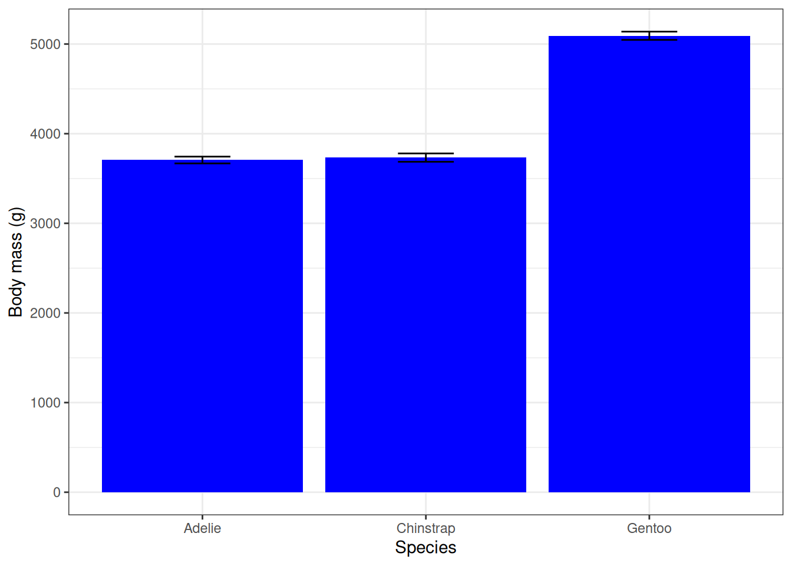

# (PART) Week 2 {-}

# Introduction

## The LEC R server

The LEC R server is now up and running! This means we'll no longer have to use AppsAnywhere.

The LEC R server can be found at [https://lec-rstudio.lancaster.ac.uk](https://lec-rstudio.lancaster.ac.uk) (the link is also on Moodle). You will log in with your normal Lancaster University username and password. 

There are two main benefits to using the R server.

1. It is accessed through a browser window, and as long as you are on Lancaster University internet, you will not need to download any software and it will work the same way on any device.

2. The file storage is more reliable than on the AppsAnywhere version of R.

## Connecting to the R Server off campus

If you are off campus (and therefore not using Lancaster University internet), you will need to use the Global Protect VPN, which allows you to access some services and IT as if you were physically located on campus.

There are instructions for how to set up the VPN on your personal computer at: [https://portal.lancaster.ac.uk/ask/vpn/](https://portal.lancaster.ac.uk/ask/vpn/).

::: {.rmdtip}
**Tip:** If you are not comfortable using the VPN, I recommend doing your R coursework on campus - either on a university computer (in the library or a computer lab) or on your personal laptop in a study space like the library or the LEC atrium.
:::

## Organising your files

If you haven't done so yet, open the [LEC R Server](https://lec-rstudio.lancaster.ac.uk) in a browser and log in. 

You should use a standard set of folders keep your files organised on the server. (Getting into this habit makes it easier to share your work with others or keep it synced across multiple devices.)

Use the "Create a new folder" icon (a yellow folder with a plus sign inside of a green circle on the top left of the Files pane) to create three new folders:

- code
- data
- results

::: {.rmdwarning}
**Warning!** It's very important that you name the folders exactly as described above - including the use of capital vs lowercase letters - otherwise the example code will not work for you.
:::

Click on File > New File > R Script to create a new R script. 

Save the R script in the `Code` folder with the name `Week2Practical` (or something similar). 

## Uploading files to the R Server

You will need to upload any data files that you want to analyse to the R server.

Download this week's data set (`palmer_penguin_data.csv`) from the Statistical Analysis Components section on the LECX5141 Moodle page.

This is a well-known dataset containing **morphological data collected from penguins near Palmer Station in Antarctica in 2007-2009.** The project was led by [Dr Kristen Gorman](https://www.uaf.edu/cfos/people/faculty/detail/kristen-gorman.php), a marine biologist at the University of Alaska Fairbanks.

Upload the data file to the R server and save it to your `Data` folder.

- The upload button is in the `Files` pane in the bottom-right pane. It it near the the middle of the tool bar at the top and has a golden circle with a white arrow pointing up.

You should also upload your R script from week 1 and save it to the `Code` folder, so that all of your work from the module will be saved in one location.

## Loading packages

Last week (when we were using AppsAnywhere to access R) we installed and loaded two packages - `tidyverse` and `psych`. 

I mentioned that the `tidyverse` package is actually a collection of many other packages.

From now on we'll load each of the tidyverse packages that we want to use separately, since that's how they are installed on the LEC R server.

Add a header and the code to load the following packages to your blank week 2 script, as shown below:


``` r

##### Your Name
##### LECX5141 - Week 2 Practical
##### 16 Oct 2026


library(dplyr)
library(tidyr)
library(ggplot2)
library(psych)

```

Run the code to load the libraries.

## Data file formats

Last week we used the built-in `iris` dataset for convenience, but this week we'll learn how to read our own data into R.

Many datasets are stored as Excel files. Excel files can contain lots of complex information besides text, like pretty formatting (coloured cells, bolded text, etc.), formulas with cell references, and graphs.

However, R can't read Excel files directly, and it doesn't like all those extra bells and whistles.

R needs the data as a comma separated value, or `.csv` file, that **only contains information as text** (i.e. numbers, letters, and certain types of punctuation).

::: {.rmdtip}
Any Excel file can be saved as a `.csv` file using the 'Save As' menu option.
:::

You'll practice doing it yourself in a later practical, but for today's exercise, the data is already in the correct format.

Unsurprisingly based on the name, a `.csv` file has values separated by commas. You can open one in a text editor and it will look something like this:

<div style="text-align: center;">

{width=100%}

</div>

Yuck. Pretty difficult for a human to work with, but it's perfect for R.

## Reading in data

Next you will read the data into R using the `read.csv()` function, and store it (using the arrow operator) as an object called `pengdata`.

::: {.rmdtip}
**Important! ** R needs to know where to look for the data file.

The best way to tell R where to look is by using something called "relative file path". Instead of looking for an exact location (that might vary between different computers, e.g. if you share your code with someone else), it looks relative to R's current location, also known as the "working directory". 

In the file path below:

- the `.` means R will start in the working directory (for the R server, this is the top level of your server account)
- then it will look inside the `data` folder
- then it will look for a file named `palmer_penguin_data.csv`
:::

Type the code below into your script file and run it.


``` r
pengdata <- read.csv("./data/palmer_penguin_data.csv")
```

You should see the data frame in your Environment tab now.

Take a couple minutes to examine it and determine:

- How many rows and columns are there?
- What do each of the columns mean? 
- What type of data does each column contain?

Today you are going to focus on body mass and try to answer the following questions about the Palmer Penguin dataset:

::: {.rmdquestion}
**Research questions:**

1. Does body mass look Normally distributed?

2. How much does the body size differ:
- between different species?
- between different sexes? 
:::


# Visualising distributions


The first step for determining if data are Normally distributed is to inspect it visually.

(Next week we'll learn two different statistical tests for Normality, but this week we'll stick to visual inspection.)

## Basic histograms

Histograms are used to plot one variable at a time, with the observed value of the variable on the x-axis and the number of observations of each value on the y-axis.

The code below will generate a histogram of the body mass data.

For most `ggplot` figures, the aesthetic function (`aes()`) must include two variables, `x` and `y` - note that this is not the case for histograms, which only plot one variable at a time.

Type it into your script and run it. Talk to a neighbour and make sure that you both understand what each part is doing.


``` r

# Box plot of petal length by species
ggplot(data = pengdata, aes(x = body_mass_g)) +
  geom_histogram()
```



When you make a histogram, you may get a message about bin sizes. This is R trying to be helpful and let you know about different ways you can modify the code. 

Note that it mentions an argument for the `geom_histogram()` function called `binwidth`. Add it now and try out different values to choose a bin width that you think is the most helpful. (Some suggested extreme values to try: 20 and 500.)

(There is also a warning about removing two rows that we'll get to later - you can ignore it for now.)


``` r

# Box plot of petal length by species
ggplot(data = pengdata, aes(x = body_mass_g)) +
  geom_histogram(binwidth = 20)
```



::: {.rmdquestion}
**Q:**
Do the data look Normally distributed? Why or why not?
:::

Some types of variables are not Normally distributed because of the nature of the variable itself.

For example, measures of income are usually quite right-skewed, because it's bounded by zero on the left but can go up to many times the median and mean values on the right.

<div style="text-align: center;">

{width=100%}

</div>

Our penguin body mass data look quite right-skewed, similar to this disposable income distribution.

However, in this case, it might not be be because of the nature of the variable itself - body mass - but rather because there is a hidden structure to the data that is making it not Normal.

## Using a facet wrap to split data by another variable

Let's try to make some histograms where we split the data by other variables that might be important for determining body mass: species and sex. (We'll go back to letting R use the default bin width.)

we'll use a function in `ggplot` called `facet_wrap()`.

Facet-wrapping allows you to split data into multiple panels by another variable, in this case species or sex.

To make a face wrap:

- Add another layer - with a plus sign!
- Use the `facet_wrap()` function
- It needs an argument - `vars()` with the name of the variable you are splitting by inside

Type and run the following code:


``` r
ggplot(data = pengdata, aes(x = body_mass_g)) +
  geom_histogram() +
  facet_wrap(vars(sex))
#> `stat_bin()` using `bins = 30`. Pick better value
#> `binwidth`.
#> Warning: Removed 2 rows containing non-finite outside the scale
#> range (`stat_bin()`).
```



::: {.rmdquestion}
**Q:**

1. Do the data look Normally distributed when split by sex? Why or why not?

2. Do you notice anything else surprising about the data?
:::

Hopefully you noticed that for some of the penguins they were unable to determine their sex, so it is listed as "NA". We'll show how to remove this data in the next section. 

For now, copy and paste your histogram code to create a copy. 

Modify the copied code to split the data by species instead of sex.

**Hint:** You will have to modify the name of the variable inside of the `vars()` function.

::: {.rmdquestion}
**Q:**
Do the data look Normally distributed when split by species? Why or why not?
:::

## Using a facet grid to split data by two variables

We can use a similar function called `facet_grid()` to split our data by two variables at the same time. 


``` r
ggplot(data = pengdata, aes(x = body_mass_g)) +
  geom_histogram() +
  facet_grid(vars(species), vars(sex))
#> `stat_bin()` using `bins = 30`. Pick better value
#> `binwidth`.
#> Warning: Removed 2 rows containing non-finite outside the scale
#> range (`stat_bin()`).
```




# Dealing with NAs

Often times we need to analyse a dataset with missing data.

In R, any missing data in our `.csv` file will get an `NA` added when it is read into R and turned into a data frame. 

However, NAs can create problems in our analysis.

For example, try to calculate the mean body mass using the code below. (Remember that you can use autocomplete to fill in the data frame and column names.)


``` r

mean(pengdata$body_mass_g)
#> [1] NA
```
This is why the code for the first histogram plot gave us a warning about removing two rows - there were two penguins that didn't have mass values, and so those rows were removed from the plot.

## Ignoring NAs in a specific function

Some functions will allow you to add an argument (`na.rm = TRUE`) to ignore NAs.

Copy and paste the code to calculate the mean above, and then add the argument to ignore the NAs. Remember, multiple arguments in a function must be separated by a comma!

## Removing all NAs from a dataset

Sometimes we will want to remove all rows in a dataset that contain any NAs. 

The function to do this is `na.omit()`.

We'll save a `cleaned` version of the penguin dataset below that has all of the NAs removed. This will make the rest of our analysis work better.


``` r

pengdata_clean <- na.omit(pengdata)

```

Try changing the data frame argument in your code to plot the histograms split by species and sex - use `pengdata_clean` instead of `pengdata`.

::: {.rmdquestion}
**Q:**
How has the histogram output changed from before?
:::

From now on, whenever we provide the name of the data frame, we'll use `pengdata_clean` instead of `pengdata`. 


# Summary statistics 


Last time we showed you two functions to quickly calculate summary statistics for an entire data frame - `summary()` in base R and `describe()` in the `psych` package.

Try them again now with your cleaned penguin data set. 


``` r
summary(pengdata_clean)
#>    species             island          bill_length_mm 
#>  Length:333         Length:333         Min.   :32.10  
#>  Class :character   Class :character   1st Qu.:39.50  
#>  Mode  :character   Mode  :character   Median :44.50  
#>                                        Mean   :43.99  
#>                                        3rd Qu.:48.60  
#>                                        Max.   :59.60  
#>  bill_depth_mm   flipper_length_mm  body_mass_g  
#>  Min.   :13.10   Min.   :172       Min.   :2700  
#>  1st Qu.:15.60   1st Qu.:190       1st Qu.:3550  
#>  Median :17.30   Median :197       Median :4050  
#>  Mean   :17.16   Mean   :201       Mean   :4207  
#>  3rd Qu.:18.70   3rd Qu.:213       3rd Qu.:4775  
#>  Max.   :21.50   Max.   :231       Max.   :6300  
#>      sex                 year     
#>  Length:333         Min.   :2007  
#>  Class :character   1st Qu.:2007  
#>  Mode  :character   Median :2008  
#>                     Mean   :2008  
#>                     3rd Qu.:2009  
#>                     Max.   :2009
describe(pengdata_clean)
#>                   vars   n    mean     sd median trimmed
#> species*             1 333    1.92   0.89    2.0    1.90
#> island*              2 333    1.65   0.71    2.0    1.57
#> bill_length_mm       3 333   43.99   5.47   44.5   43.98
#> bill_depth_mm        4 333   17.16   1.97   17.3   17.19
#> flipper_length_mm    5 333  200.97  14.02  197.0  200.36
#> body_mass_g          6 333 4207.06 805.22 4050.0 4159.46
#> sex*                 7 333    1.50   0.50    2.0    1.51
#> year                 8 333 2008.04   0.81 2008.0 2008.05
#>                      mad    min    max  range  skew
#> species*            1.48    1.0    3.0    2.0  0.16
#> island*             1.48    1.0    3.0    2.0  0.62
#> bill_length_mm      6.97   32.1   59.6   27.5  0.04
#> bill_depth_mm       2.22   13.1   21.5    8.4 -0.15
#> flipper_length_mm  16.31  172.0  231.0   59.0  0.36
#> body_mass_g       889.56 2700.0 6300.0 3600.0  0.47
#> sex*                0.00    1.0    2.0    1.0 -0.02
#> year                1.48 2007.0 2009.0    2.0 -0.08
#>                   kurtosis    se
#> species*             -1.72  0.05
#> island*              -0.85  0.04
#> bill_length_mm       -0.90  0.30
#> bill_depth_mm        -0.91  0.11
#> flipper_length_mm    -0.98  0.77
#> body_mass_g          -0.75 44.13
#> sex*                 -2.01  0.03
#> year                 -1.49  0.04
```

::: {.rmdquestion}
**Q:**
Based on our histogram visualisations, why might these functions not be that useful to us for this dataset?
:::

Sometimes we'll need to calculate summary statistics with our dataset divided into certain groups or _subsets_ of the data (e.g. by sex and species).


## Means and SE with `summarise()`

There is a function in `dplyr` called `summarise()` that is very useful for calculating summary statistics on subsets of data.

`summarise()` will perform any calculation that you tell it to on your dataset. In this case, we'll use it to calculate:

- the mean
- the standard deviation
- the standard error

To tell R to subset the data by species, we'll include another argument in `summarise()`: `.by = var_name`, where `var_name` is the name of the variable (i.e. the column name) that we are subsetting by (in this case, species, sex or both).

When we calculate summary statistics with summarise, we'll want to save the output as a new data frame and pipe in the original data frame with all of the raw observations.

Afterwards, we can either examine the output by clicking on it in our Environment pane or by printing it to the console.

Type the following code in your script and run it. This has two of the three calculations that we want.


``` r
pengdata_species_summary <- pengdata_clean |>
 summarise(mass_mean = mean(body_mass_g),
           mass_SD = sd(body_mass_g),
           .by = species)
print(pengdata_species_summary)
```

Modify the code to add in the calculation for standard error. 

Remember that the formula for the standard error, based on the standard deviation ($\sigma$) and the number of data points ($n$), is:

$$\mathrm{SE} = \frac{\sigma}{\sqrt{n}}$$

::: {.rmdtip}
**Tips:** 

1. When you add a new argument to a function, it must be separated from the other arguments by a comma.

2. A good way to calculate the number of observations in a column is to use the `length()` argument.
:::


### Subsetting by multiple variables

If you want to `summarise()` over multiple variables, you will need to give them in the `by =` argument as a _vector_. 

Copy and paste your `summarise()` code from above to duplicate it.

Modify the duplicated code to calculate the means and SE over both sex and species.

::: {.rmdtip}
**Tips:**

1. You will want to create a new output data frame with a different name - I suggest `pengdata_speciessex_summary`.

2. Remember that the way to create a vector in R is with the lowercase letter `c` for `concatenate`. 
:::


# Bar plot with error bars


The final coding task for today (before you tidy up) will be to create a column plot of the body mass means with the standard errors plotted as error bars.

For simplicity, we will only use the data summarised by species(`pengdata_species_summary`), not by species and sex.

To make a column chart, you will use the `geom_col()` function to add the data layer. 

To start, type and run the code below to make a basic column plot using the data summarised only by species.


``` r

ggplot(data = pengdata_species_summary,
       aes(x = species, y = mass_mean)) +
  geom_col() +
  labs(x = "Species", y = "Body mass (g)") +
  theme_bw()
```



## Adding error bars

To add error bars, you will use the function `geom_errorbar()`.

However, the error bars use different data than the columns themselves - the standard error and not the means. 

Therefore, we'll have to provide the new data with a new `aes()` function.

Spend a couple minutes thinking about what the data will be. 

::: {.rmdquestion}
**Qs:**

1. What numerical values do you want to be the tops and bottoms of your error bars? (Hint: it is not the SE values themselves)

2. How might you tell R how to calculate them? 
:::

The values for the error bars are not the raw SE calculations - they are the SE values _off-set from the mean_. 

This means we will have to tell R to do some math:

- The top of the error bars (`ymax`) will be the mean + SE
- The bottom of the error bars (`ymin`) will be the mean - SE

Add the following layer to your code - after the `geom_col()` - to add error bars to your figure.

The `width` argument is making the width of the error bars smaller - otherwise they will be the same width as the columns.

```
  geom_errorbar(aes(ymax = mass_mean + mass_SE, ymin = mass_mean - mass_SE, width = 0.25)) +

```



Try changing the colour by the adding the argument `fill = "blue"` to the `geom_col()` function.



Yikes, that's a bit bright. 

Choose a colour that you like better either using [named colours](https://derekogle.com/NCGraphing/resources/colors) or [hexadecimal codes](https://streamlinepublishing.com/inside-art/who-put-the-hex-on-color/) (e.g. use `fill = "#66CCEE"`)

## Tidying up

For your tasks today, tidy up and save your R script, like last time.

Remember to:

- Make sure that your code is sufficiently commented, so that someone else (or you during the end of module test!) can understand what you did.
- Delete any spare lines of code that you don't need anymore (e.g. for testing something that didn't work right away).

