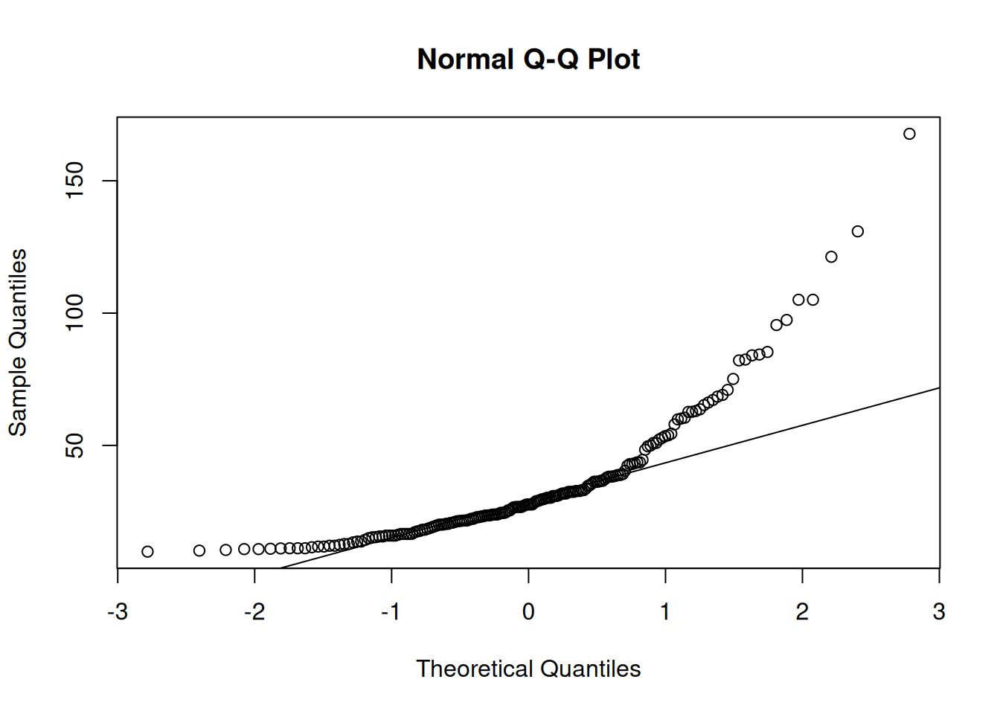
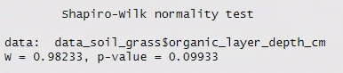
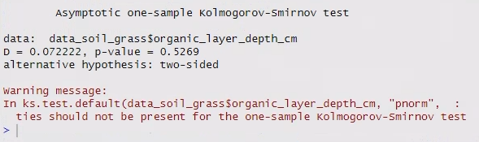

# (PART) Week 3 {-}

# Introduction {#intro_wk3}

In today's practical,  you will learn how to formally and rigorously evaluate the Normality of a dataset.

## Prepare a new script and load packages

Starting today, the first thing you'll do at the beginning of each R practical is:

1. Open a new R script.
2. Save it under a sensible name (e.g. for today, something like `Week3Practical`) in your code folder
3. Add in a header to explain what the script is
4. Add in the code to load our three main packages/libraries
5. Run the code the load the libraries

For points 3 and 4, the easiest thing is to open your script from last week, copy and paste the relevant content, and then change the information that needs to be updated (e.g. the date and the practical number/topic in the header).

::: {.rmdcaution}
***Caution!***

As you work, make sure that you are adding in:

- Spaces between your variables, operators, functions, and arguments
    - **Good:** `data <- read.csv("file.csv")`
    - **Bad:** `data<-read.csv("file.csv")`)
- Extra line spaces between sections of related code.

This will make your code much easier to read and debug.

Starting today, **we will not help you with your code until it is properly spaced**.
:::

::: {.rmdtip}
***Tip!***

Speaking of spaces, it's a good idea to avoid putting spaces in file names.

Try to get in the habit of using underscores or hyphens instead - like we do in the data files and example scripts.
:::

## Today's data

Today's dataset is **tree circumference data** from the forested strip of Lancaster University land between campus and the M6 motorway.

It was collected in week 1 of this year by the new cohort of first year ecology and zoology students for a field practical in the LECX4141 Ecology module. (You are seeing the data before they are.)

### Download and upload the data

Download today's dataset (`"tree_circumference_data.csv"`) from the _Statistical analysis components_ section on the Moodle page.

Upload the file to the R server and move it into your data folder. 

### Read in the data

Find the code to read in data from a .csv file in your script from last week.

Copy and paste it into this week's script.

You will need to change two things before you run the code:

1. The name of the data frame you are using to store the data (I suggest something like `data_tree`).
2. The name of the .csv file in the file path.

Once you run the code, you should see the data frame in your Environment tab.

### Examine the data

Take a couple minutes to examine it and determine:

- How many rows and columns are there?
- What do each of the columns mean? 
- What type of data does each column contain?
- If there is a character column, how many different values are there in it?

::: {.rmdtip}
**Tip!**

You can use the `str()` function to examine the data frame instead of clicking on it in the Environment tab.

You can use the `unique()` function to return all unique values of a variable.

**NOTE:** In the example code below, you will need to substitute `mydf` with whatever you named your data frame and `mycol` with whatever the column is called.
:::


```r
str(mydf)
unique(mydf$mycol)
```

### Research questions

Today you are going to try to answer the following questions about the tree circumference dataset:

::: {.rmdquestion}
**Research questions:**

1. Is tree size Normally distributed? For the whole population? For specific species? 

2. If not, can we transform the tree size data to make them Normally distributed?
:::

Determining if data are Normally distributed is a key first step for choosing an appropriate statistical test. 

## Converting units

However, before we can get started assessing Normality, we'll need to convert the tree size units. 

Hopefully, you noticed earlier that the tree size was measured as circumference.

The standard method for measuring tree size is DBH - diameter at breast height. Thus, our analysis will better conform to ecological conventions if we convert our measurements to diameter.

You can create a new column with data from a calculation using existing columns.

- You simply need to use the `<-` operator to create the new column, like you would with any new variable (e.g. `a <- 3`).
- Any maths calculation that R can do on a single number, it can also do on a vector or data frame column. (In fact, a data frame column _is_ just a plain old vector in a funny hat.)


For instance, `a <- 2*b` will work on any numerical object `b`, regardless of what structure it is - `b` could be:

- a single number
- a list of numbers (i.e a vector)
- a data frame or matrix with many columns and rows

R will perform the mathematical operation on every single element in the input (`b`), and the output (`a`) will simply be the same structure as the input (`b`).

::: {.rmdtip}
***Tip!*** Remember that you can refer to columns in a data frame using the `$`, and use the autocomplete menu to select from existing columns.
:::

The formula to convert a circumference ($c$) to a diameter ($d$) is:

$$ d = \frac{c}{\pi} $$

In R, you can refer to the irrational number $\pi$ with the variable name `pi`. 

Use the code below as a template.

**NOTE:** you will need to substitute `mydf` and the column names with the names of your data frame and column names.

```r
# Convert tree circumference to diameter
mydf$new_column <- mydf$old_column / pi
```

# Diagnostic plots to assess Normality


## Histograms

Last week you used `ggplot()` from the tidyverse to make a histogram to assess the Normality of the penguin data.

You can look at a histogram and see if your data generally look like one symmetrical hump, or asymmetrically skewed to one side, or some other pattern (e.g. two humps - like our total area calculations).

This week we're going to use a more simple function from base R - `hist()` - to make a histogram of the tree diameter data.

The figures that `hist()` makes aren't as attractive as `ggplot()` figures, but they are fine for preliminary data exploration that you don't plan to put in a report.

Use the `hist()` function on the tree diameter data.

```
hist(mydf$mycol)
```

## Boxplots

Box and whiskers plots, often shortened to boxplots, are another common way to visualise data during the initial exploration phase and assess Normality.

You made some using `ggplot()` and the iris data in week 1, but we didn't talk about what boxplots show in detail.

Boxplots show:

- A box encompassing the interquartile range (IQR), the values between the 1st and 3rd quartiles, i.e. the 25th and 75th percentiles of the data, q25 and q75 respectively.
- A line across the centre of the box at the median
- "Whiskers" on each end representing the 5th and 95th percentiles.
- Outliers (extreme values) plotted as individual points. Specifically, outliers are identified as any points outside the whiskers with values:
  - $<q25−1.5\times\mathrm{IQR}$ or
  - $>q75+1.5\times\mathrm{IQR}$

Just like with the histogram, this week we're going to use a more simple function from base R that is simpler but not as attractive.

Use the `boxplot()` function on the tree diameter data.

```
boxplot(mydf$mycol)
```

## Normal Quantile-Quantile (Q-Q) plots

There is one other plot that is particularly useful for assessing Normality: a Normal quantile-quantile or Q-Q plot.

The Normal Q-Q plots are generated as follows:

- The data set is divided into quantiles - like quartiles but a more generic way of sectioning the data into bins equal densities of the data points, ranked from lowest to highest.
- The observed quantiles in your data are plotted (on the y-axis) against the predicted quantile for a Normally-distributed data set (on the x-axis).
- A line is drawn through the first and third quantiles (the 25% and 75% values of the data.)

You can interpret the Q-Q plot as follows:

- If your data are Normally-distributed, the points will all lie on the straight line plotted on the graph.
- An S-shaped curve indicates that the distribution has heavier or lighter tails than expected.
- A curve bending upward indicates that the distribution is positively/right-skewed.
- A curve bending downward indicates that hte distribution is negatively/left-skewed.

In R, you make a Q-Q plot with the two functions below (the first one plots the points and axes, the second one plots the line):

- `qqnorm(mydf$mycol)`
- `qqline(mydf$mycol)`

Make a Q-Q plot of the tree diameter data.



::: {.rmdquestion}
**Q:**

What does the Q-Q plot tell us about the tree diameter data?

Does it agree with the histogram and boxplot?

:::

## Combining multiple base R plots

It would be really nice if we could combine all our plots into one larger plot, so we could see all of them at the same time.

In base R, the easiest way to do this is with the following command:

```
par(mfrow = c(1,2))
```

The vector given to the `mfrow` argument tells R the number of rows and columns that you want in your final figure, respectively. So the code above will make 1 row with 2 columns.

Use the following template to make a figure with all three diagnostic plots.

```r
# Make diagnostic plots for Normality
#      - a histogram a boxplot, and Q-Q plot with a line
par(mfrow = c(1,x)) # 3 panels in 1 row
hist(mydf$mycol)
boxplot(mydf$mycol)
qqnorm(mydf$mycol)
qqline(mydf$mycol)
```


# Formal tests to assess Normality

The Shapiro-Wilks and Kolmogorov-Smirnov (K-S) tests are more quantitative methods of evaluating whether or not your data are Normally-distributed.

Essentially, these tests look for the difference between your data points and a Normal distribution with the same mean and standard deviation, and tell you whether or not this difference is statistically significant.

## Which test to use

The Shapiro-Wilks test is more sensitive and powerful than the K-S test.

Therefore, it is generally recommended to use Shapiro-Wilks when you have smaller sample size (n < 50). It has been shown to work well with samples as small as n = 20.

For larger sample sizes (n > 50), the K-S test is less likely to find a false positive, i.e. find a significant difference from Normality, despite the date being Normally distributed.

## Defining hypotheses

First we should define our hypotheses. They are:

- $\mathrm{H}_0$: The distribution of the [e.g. tree circumference] data is not significantly different to a Normal distribution. (It is a normal distribution)
- $\mathrm{H}_\mathrm{A}$: The distribution of the [e.g. tree circumference] data is significantly different to a Normal distribution. (It is not a normal distribution)

When you run these tests in R, you will get output that looks something like this:

<div style="text-align: center;">

{width=100%}

</div>

<div style="text-align: center;">

{width=100%}

</div>

The critical points in these outputs are:

- the test statistics (W for Shapiro-Wilk and D for Kolmogorov-Smirnov)
- the p-value

:::{.rmdtip}
You can ignore the warning message about ties for the K-S test.

If you have repeated values (i.e. "ties") in your data due to rounding, it will make the test slightly less likely to reject the null hypothesis, but that's generally okay.

However, this might affect your decision for how much to round your data.
:::


The test statistics here are a measure of the difference between the distribution for the data and the distribution for a specified distribution (Normal in this case). 

The p-value is the probability of being wrong if we reject the null hypothesis. If P < 0.05 we normally reject the null hypothesis.

For example, here the p-values of 0.10 (S-W test) and 0.53 (K-S test) for the grassland depth data mean a 10% and 52% probability of being wrong if we decide to reject the null hypothesis ($\mathrm{H}_0$: the distribution is not significantly different to a Normal distribution).

Since we are quite likely to be wrong, so we not should reject $\mathrm{H}_0$, i.e. the distribution is not significantly different to a Normal distribution. The larger the p-value the more likely it is that the distribution is Normal.

## Shapiro-Wilk test

The function in R for the Shapiro-Wilk test is `shapiro.test()`.

Run the test below on the tree diameter data.

```
shapiro.test(mydf$mycol)
```

:::{.rmdquestion}
***Q:*** Are the tree diameter data Normally distributed?
:::

Based on the Shapiro-Wilk tests:

- We can reject the null hypothesis for tree diameter being Normally distributed.

The histogram and boxplot also supports this decision. When we accept the null hypothesis, it doesn't mean that we are 100% confident that our data are exactly Normal, simply that we couldn’t detect a difference from a Normal distribution.

:::{.rmdwarning}
**Be careful!:**

- With very large sample sizes (when strict Normality is less important), the test is more likely to cause you to reject $\mathrm{H}_0$.
- With small sample sizes (when it’s very important to know if your data are non-Normal), you are more likely to accept $\mathrm{H}_0$.

Therefore, we should ALWAYS pay strict attention to the histograms and descriptive statistics in addition to these tests when making a decision about Normality.
:::

## Kolmogorov-Smirnov test

Now let's do the Kolmogorov-Smirnov test and see if we get the same answer for rejecting or accepting our null hypotheses.

The function for Kolmogorov-Smirnov test is `ks.test()`. It can actually test for other distributions besides the Normal distribution. It takes 4 arguments in a specific order:

1. the data
2. the distribution to test for - for Normal, use the argument `"pnorm"` - with the quotation marks
3. the mean of the data
4. the sd of the data

Our code for the K-S test will take three lines:

- In the first two lines, we'll store the mean and SD of our data to make them easier to refer to in the test.
- In the third line we'll run the test.

Write the code below into your R script.

```r
# K-S test 
#    - need to calculate and store the data's mean and sd before running test
mean_mc <- mean(mydf$mycol)
sd_mc <- sd(mydf$mycol)
ks.test(mydf$mycol, "pnorm", mean = mean_mc, sd = sd_mc)
```

Run the K-S test for the tree diameter data.

:::{.rmdquestion}
***Q:*** How do the answers from the K-S test compare to the answers from the W-S test?
:::


# Writing functions

Writing your own functions is really helpful if you need to repeat a complex set of tasks multiple times.

For example, to check if a variable is Normally distributed, you need to perform all of these analyses:

1. calculate skew
2. compare mean and median
3. make a histogram 
4. make a boxplot
5. make a qqplot with a qqline
6. perform a formal test of Normality

From now, we will have to do this long list of tasks for multiple variables in every practical!

Wouldn't it be really convenient if we could do all the tasks listed above with just one command?

You can if you write your own function to do it!

## Defining a new function

To define a function in R you:

- Name the function
- Tell R it is a function, using a function called `function()`
- Put the names of any arguments that the function will need inside the brackets of `function()`
- Use curly brackets to contain all the commands that the function will do

Write the following code into your R script.

Here, our new function - `examine_norm()` - takes one argument, which we are calling `var_x`.

Right now the function is empty and doesn't do anything. (We'll fill it in shortly.)

```r
# Define a function to analyse Normality of a variable
examine_norm <- function(var_x){}
```

## Adding commands

We want our function to do all the analyses necessary to determine if a variable is Normally-distributed.

Let's start by adding the commands to make our three diagnostic plots, as shown below.

- Put your cursor in between the curly brackets and hit enter a few times to make some space.
- Retype or copy and paste your old code for making our 3-panel figure with a histogram, a boxplot, and a qq-plot inside the curly brackets.
- Change the arguments in the plotting code to match the argument name we used in the first line (`var_x`).

Now whatever data we give our function as the argument, R will use wherever the function code says `var_x`.

:::{.rmdtip}
**Tip:** The argument `var_x` will exist as a temporary object while the function is running, and then get removed afterwards. This means we will not be able to use or refer to `var_x` outside the function itself.
:::

Your code should now look like this:

```r
# Define a function to analyse Normality of a variable
examine_norm <- function(var_x){
	
	# Make 3-panel diagnostic plots
  # <YOUR CODE GOES HERE>

}
```

## Loading and running the function

Before we can use our function, we need to load it into our Environment.

Put your cursor in the top line of the function definition (or highlight the whole section) and run it. 

You should see the function pop up in your Environment pane.

:::{.rmdquestion}
***Q:*** What information does R provide about your function in the Environment pane?
:::

Now we can actually use our function!

Write the following code below the function definition in your R script, and run it.

```r
# Examine Normality of the column
examine_norm(mydata$mycol)
```

You should see our classic figure with the three diagnostic plots pop up in your Plots pane.

:::{.rmdtip}
**Tip:** "Running" a function is sometimes referred to as "executing" the function.
:::

## Finishing our function

Our function is already really useful, but we can make it even more useful.

Let's add the code for the formal Normality tests (Shapiro-Wilk test and Kolmogorov–Smirnov test) to our function. Modify the function definition as shown below so it:

- performs a Shapiro-Wilk test and prints the output
- performs a Kolmogorov–Smirnov test and prints the output

:::{.rmdtip}
**Tip:** You can nest functions inside of each other! R will perform the outer function - `print()` - on the results of the inner function - `shapiro.test()` or `ks.test()`.
:::

Your code should now look someething like this (I've done a little for you because I'm nice).

```r
examine_norm <- function(var_x){
	
	# Make 3-panel diagnostic plots
	# <YOUR CODE GOES HERE>
	
	# Shapiro-Wilk test
	print(shapiro.test(var_x)) # Here's some nested function calls!

  # Kolmogorov–Smirnov test - calculate and store the data's mean and sd first
  # <YOUR CODE GOES HERE>

}
```

Now that we've changed the definition our function, we will need to load it again before R can use the new version of it.

Re-load the function, and re-run the line that runs the function.

You should see the output of the Shapiro-Wilk test print in the Console. (It will also make a new figure, but it won't be obvious since it's the same one as before.)

Let's add another set of commands to our function to calculate and print the relevant descriptive statistics: the mean, median and skew.

Here will also take advantage of a function called `paste()`, which pastes text output together.

The new code below will:

- Calculates the mean median, and skew.
- Prints each these calculations along with text saying what it is

```r
# Define a function to analyse Normality of a variable
examine_norm <- function(var_x){
	
	# Calculate descriptive statistics
	print(paste("Mean =", mean(var_x)))
	# <YOUR CODE GOES HERE>
	# Make 3-panel diagnostic plots
	
	# Shapiro-wilk test
	print(shapiro.test(var_x))

  # Kolmogorov–Smirnov test - calculate and store the data's mean and sd first
  # <YOUR CODE GOES HERE>

}
```

Add this to your own code and add lines to calculate and print the median and skew values of `var_x`.

For median this should not be hard, however if you try and use some sort of function called `skew()`, you may notice something. **It doesn't exist in base R!**

### Making our own skew function

The calculation for skew is a little complicated. The equation is below (but don't worry too much about it).

$$\mathrm{skew} = \frac{\frac{\sum (x - \bar{x})^3}{n}}{\left(\frac{\sum (x - \bar{x})^2}{n}\right)^{1.5}}$$

For your convenience, below I have provided a copy-pastable function to calculate skew.


``` r
# Function to calculate the skew of a vector
skew <- function(x) {
  n <- length(x)
  m3 <- sum((x - mean(x))^3) / n
  m2 <- sum((x - mean(x))^2) / n
  return(m3 / (m2^1.5))
}
```

Copy this function into your script and run it so we can then use the function `skew()` later.

Now add a call to `skew()` into your script underneath the line where you print the `median()` of the data.

:::{.rmdtip}
**Tip:** As you can see, you can use one function that you defined within another one that you also defined! This is incredibly useful as you can eventually build up a set of functions and use them to write other functions to save even more time.

Make sure that you load all the functions that you're going to use, however. If a function used within another is missing, you'll get an error.
:::

_Note: there actually IS a skew function within the `psych` package, however you sometimes don't have access to a package, or don't want to load the whole thing just for one function._

## Resetting the plot window

Let's make one final addition to our function that is not required, but will make it easier to work with.

- Right now your function should be changing the plotting settings to plot 3 figures in a single row, in the line `par(mfrow = c(1,3))` (if you've got the right stuff in there).
- That is great for our diagnostic plots, but what if we want to make a normal plot at some point later one?
- We can fix this by adding code to re-set the original plotting settings after we've done our analysis.

Add the following line of code to your function. You can decide where to put it, as long as it is after the plotting. It could be either before or after the for Normality tests - it doesn't matter.

```r
par(mfrow = c(1,1))
```

Now we can fully analyse any variable for normality using a single line of code!

You just have to remember to load your `examine_norm()` function at the beginning of your R session, when you loading your data and packages.


# Transforming data

There are two kinds of statistical tests.

- **Parametric tests**, which assume that your data are Normally-distributed
- **Non-parametric tests**, which do not assume the distribution of your data.

Parametric tests are more powerful and sensitive, i.e. more able to get significant p-values and reject null hypotheses for the same input data. 

While some small deviations from Normality can be ignored, when your data are very skewed you will need to take countermeasures.

One option (and the one that we will be using here) is to apply a **transform**, which will change the distribution of your data set. This is much less complicated than it sounds. It simply means that we are going to put each of our data points into an equation, and find the new value. We can then test our new distribution for Normality (and do our statistical tests on the transformed data set).

Non-parametric tests are frequently used when we have a very small data set, are working with non-continuous data, or we have a non-Normal data set. However, these tests are not as sensitive or powerful as parametric tests, so if we have a large data set (n > 30), it is better to try and transform the data.

We transform data when the mean value is not representative of the “typical” member of the population (because, for example, the data are skewed). The extreme values have a strong influence on the mean, but we don’t want to discard them. They are still valid and important data points. Instead, we transform the data to make the distribution more Normal, which reduces the outsized influence of the extreme values.

When we transform data, we:

- Don’t change the rank order of the data (the biggest value is still the biggest and the smallest still the smallest).
- Don’t remove any data points (the extreme data points are still there).
- The influence of the extremes is reduced. They still contribute to the mean of the transformed data set, but no longer dominate our results.

## Transformations in R

We are now going to practice transforming data, using the tree data as an example.

We are going to investigate three transforms that are useful for positive skew, positive kurtosis, and unequal variances, namely:

- log10 ($\log_{10}x$)
- square root ($\sqrt x$)
- negative inverse ($\frac{-1}{x}$).

:::{.rmdquestion}
***Questions:***

- What are the three transformations you are performing?
- What are they doing to your data?
- Why are you performing them?
:::

Transforming variables in R is very easy - you can use the same general method you used to convert the tree size units from circumference to diameter (e.g. use an old column to make a new column).

:::{.rmdimportant}
***DO:*** Re-read the three bullet points above again. Make sure you understand them.
:::

:::{.rmdquestion}
***Q:*** Could you explain to a classmate why we are doing what we are doing and how it works? If not, go back to the top of this section and refresh yourself.
:::

However, we don't want to transform our variables at the bottom of our script where we are currently working - we want to do it at the top, so we can more easily include it in the rest of our analysis.

Scroll up to the top of your script, **right after you load the data**.

:::{.rmdtip}
**Tip!**

Generally speaking, you will run your script from top to bottom.

If you decide to something (e.g. transform you data) before you do other analyses (e.g. make plots or run tests), you will want to do that earlier in the script.

Therefore, as you write a script, you may want to be moving around so the order of commands make sense based on the analysis, not necessarily the order that you wrote them in. 
:::

Type the following code into your script and run it. (Remember you can use R's autocomplete feature so you don't have to write out long variable names).

```r
# Create new columns in the original data frame with transformed values

# Transformations are: 
# 1) log10
# 2) squareroot, and
# 3) negative inverse (-1/x)

mydf$mycol_log10 <- log10(mydf$mycol)
mydf$mycol_sqrt <- sqrt(mydf$mycol)
mydf$mycol_neginv <- -1/mydf$mycol
```

:::{.rmdwarning}
**Warning!** Remember that this code won't just work copy-pasted. You'll need to change `mydf` and `mycol` to appropriate values!
:::

Now scroll down to the section of your script where you run diagnostics for Normality diagnostic plots.

Write some new code to use your `examine_norm()` function on these new columns with the transformed data.

:::{.rmdquestion}
***Questions:***

- Have any of the transformations made the tree data less skewed?
- Do any of the transformed variables look more Normal than the original variable?
- Do any of the transformations change the results from your S-W or K-S tests on the original variable?
:::

These transforms work best on positively skewed data. However, there are other transforms that you can use (see for example Townend “Practical Statistics for Environmental Scientists”), but this is a reasonable selection to start with. (In fact, log-Normal data are very common, meaning that the log transform is often the only one you will need).


# Filtering data

## Logical comparisons in R

Most programming languages (including R) use a standard set of operators to compare values.

These comparisons or tests will output something called a "boolean" value that is either `TRUE` or `FALSE`.

- `x == y` tests if x and y are equal
- `x != y` tests if x and y are **not** equal
- `x < y` tests if x is less than y
- `x > y` tests if x is greater than y
- `x <= y` tests if x is less than or equal to y
- `x >= y` tests if x is greater than or equal to y

Type out the following code below and run it line by line while looking at the output in your console.

Make sure that you understand how each line is working.

```r
1 == 2
1 != 2
1 < 2

# Create a vector
test_vec <- c(1, 2, 3, 4, 5)

test_vec == 3
test_vec != 3
test_vec < 3
test_vec > 3
test_vec <= 3
test_vec >= 3
```

R also has another operator that can be used to determine if a specific value is found within a vector: `%in%`. 

In the next section, we'll show you how the `%in%` operator can be really useful.

For now, type and run the code below to show yourself how it works.

```r
3 %in% test_vec
6 %in% test_vec
```

You can delete this code from your script once you are satisfied that you know how it functions.

## Filtering data

Let's say that I am interested in the circumference of only Sycamore and Beech trees. We know that I have this data in my `data_tree` dataframe, however there's a bunch of data on other trees that I explicitly **don't** want to include.

Wouldn't it be nice if I could easily filter out the data that I do not want? Luckily R (alongside `tidyverse`) makes this really easy!

To do this, the first step is to create a vector with the names of the species I wish to keep.

Type and run the code below to create this vector.

```r
# Create vector of names of trees that you want to keep
mytrees <- c("Sycamore", "Beech")

```
::: {.rmdtip}
***Tip!*** Remember that each element in a vector must be separate by a comma!
:::

::: {.rmdquestion}
***Q:*** Why are each of the tree names given in quotation marks?
:::

Now that we have our vector of trees, we can use the `%in%` operator to filter for only the rows that match one of the elements in the vector.

We will use the `filter()` function from `dplyr`, as shown below.

:::{.rmdwarning}
Remember to make sure that `dplyr` has been loaded using `library()` before trying to use a function from it!
:::

The following code:

- creates a new data frame called `filtered_data_tree`...
- using our original dataset (which I called `data_tree`), which is piped into...
- the `filter()` function, which is given the arguments to select rows with `species` values that match an element in our vector `mytrees`

Type and run the code below. Make sure you understand what it is doing before you move on. 

```r
# Filter list by specific tree species
filtered_data_tree <- data_tree |>
  filter(species %in% mytrees)
```

::: {.rmdtip}
***Tip!*** Although we are using `%in%` for the `filter()` function here, you can also use any of the logical comparison operators (e.g. `==`, `!=`, `>`, `<`, etc.) to filter your data.

We need to use `%in%` here because we are testing to see if the species is equal to **any of the entries** in `mytrees`
:::

For our comparison, we will also want to make a list that has all of the trees **except** the ones we are interested in.

We can use very similar code - except this time we will add a `!()` nested within our `filter()` function. This will negate the selection (i.e. make all `FALSE` values into `TRUE` and vice versa), which will make it select all the rows that _do not_ match any of the values in the vector, rather than those that _do_ match one of the values. 

```r
# Filter list by specific tree species - excluding sycamore and beech
filtered_data_tree_others <- data_tree |>
  filter(!(species %in% mytrees))
```

Now run your `examine_norm()` function on the circumference column of both of these new data frames.

::: {.rmdquestion}
***Questions:***

Are there any differences?

It's worth also going back and comparing to your plots from the whole dataset.

Which of the two new plots looks most similar to the original data? Why might this be?
:::


# Tidying up {#tidyup_wk3}

Now it's time to tidy up and save your R script. 

As always, you will want to:

- Make sure that your code is sufficiently commented, so that someone else (or you later on!) can understand what you did.
- Delete any spare lines of code that you don't need anymore (e.g. for testing something that didn't work right away).

## Creating your own R cheatsheet

I **strongly** recommend creating a set of notes where you keep track of all the bits and bobs of R that you've learned.

The easiest way to do this is as a [markdown](https://www.markdownguide.org/basic-syntax/) (i.e. text) file - this will allow you to edit it and view it in RStudio, and make it more effective coding tool.

You can create a markdown file by going to: File > New File > Markdown (at the top of the 6th section down).

Here is a list of all the key functions that we've learned over the past two weeks, grouped by type and then in alphabetical order.

You can copy and paste this list into your markdown file, and then add your own annotations / descriptions that will help you remember how they work.


### General / data analysis

- `describe()`
- `filter()`
- `function()`
- `group_by()`
- `head()`
- `library()`
- `length()`
- `mean()`
- `median()`
- `na.omit()`
- `paste()`
- `print()`
- `rbind()`
- `read.csv()`
- `sd()`
- `sqrt()`
- `str()`
- `summary()`
- `summarise()`
- `tail()`
- `unique()`
- `View()`

### ggplot functions

- `aes()`
- `facet_wrap()`
- `ggplot()`
- `geom_boxplot()`
- `geom_col()`
- `geom_histogram()`
- `geom_line()`
- `labs()`
- `theme()`
- `theme_bw()`
- `vars()`

## Other plotting functions

- `boxplot()`
- `hist()`
- `par()`
- `qqline()`
- `qqnorm()`

## Statistical tests

- `shapiro.test()`
- `ks.test()`
