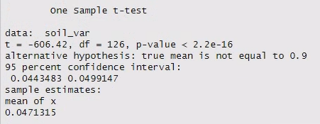
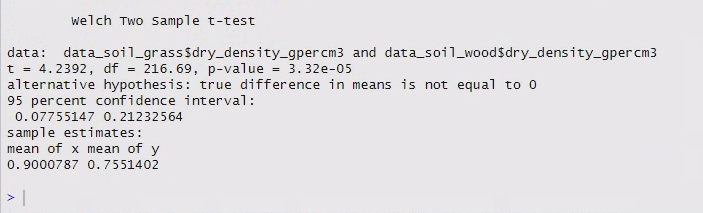

# (PART) Week 4 {-}

# Introduction {#intro_wk4}

In today's practical, you will learn learn how to use a selection of parametric tests to compare sample means in a variety of different situations. We will work through three types of t-tests (one-sample, two-sample, and paired).

We will be using two different data sets:

- The Palmer penguin data that you used in week 2.
- A new dataset measuring water quality upstream and downstream of a mine.

Download the water quality dataset from Moodle, upload it to the R server, and move it to your data folder.

## Prepare a new script and load packages

As usual, you will want to start today’s practical with the following steps:

1. Open a new R script.
2. Save it under a sensible name (e.g. for today, something like `Week4Practical`) in your code folder.
3. Add in a header to explain what the script is.
4. Add in the code to load our three main packages/libraries.
5. Run the code the load the libraries.

For points 3 and 4, the easiest thing is to open your script from last week, copy and paste the relevant content, and then change the information that needs to be updated (e.g. the date and the practical number/topic in the header).


## Read in the datasets

Read in both of today's datasets. 

Store them as `peng_data` and `wq_data`, respectively. 

## Parametric vs. non-parametric tests

Last week, we discussed that there are two kinds of statistical tests:

- **parametric** tests (which require the data to be Normally-distributed and continuous).
- **non-parametric** tests (which make no demands of the data distribution or type).

In general, if you have a reasonable sample size (at least 6 data points, but preferably more) and you have continuous data for your outcome variable, parametric tests are preferred because they are more powerful than non-parametric tests (that means they are better able to detect small differences).

If you have a reasonable sample size and continuous data for your outcome variable, but the data are not Normally-distributed (e.g. they have a positive skew), you should attempt to transform the data to make them Normal using the methods we used in week 3.

Non-parametric tests (which we will cover in future weeks) should be used if the data for your outcome variable are not continuous, or you can't find a good transformation to make them Normal.

Moving forward, we are going to frame all your work in terms of moving through The Flow Chart™ of statistical tests to give you practice selecting an appropriate test. 

## t-tests in R 

Today we will be running three different types of t-tests, which are **parametric** tests for comparing means:

- One-sample t-test
- Two-sample t-test
- Paired t-test

The test statistic for t-tests is (unsurprisingly) called "t".

R uses only one function to run all three types of t-tests: `t.test()`.

The type of t-test that the `t.test()` function performs will depend on:

- The data you give it as the main argument/s
- Other arguments that modify the settings

# Question 1 - one sample t-test {#wk4_Q1}

```{r, include = FALSE}
peng_data <- read.csv("./data/palmer_penguin_data.csv")
```

For Questions 1 and 2 we will focus on body mass of the most abundant penguin species in the dataset: the Adélie penguin.

<div style="text-align: center;">

{width=100%}

</div>


::: {.rmdquestion}
***Research Question:*** 

Do the Adélie penguins from the Palmer Island Archipelago have a body mass that is significantly different to the body mass of captive Adélie penguins in zoos (mean = 4.2 kg)?
:::

(The mean weight of various species of captive penguins can be found on page 23 of [this penguin husbandry manual](https://www.zoocentral.dk/uploads/4/9/7/5/49755431/penguin_-_aza_-_2005.pdf) - I _strongly_ encourage you to check out the illustrations when you have time.)

Because we only have one sample that we want to compare to a fixed value, we need to do a one-sample t-test.

The following questions are designed to move you through the statistical test map, aka The Flow Chart™, introduced in the lecture this week.

::: {.rmdquestion}
***Questions:*** 

Looking at the research question and the data:

- What do you think the **outcome** variable is?
- What kind of variable is it (e.g. categorical, discrete, continuous)?
- What do you think the **predictor** variable is?
- What kind of variable is it (e.g. categorical, continuous)?


Looking at The Flow Chart™:

- How far could you navigate through The Flow Chart™ based on your answers above?
- Can you get all the way to a test? Why or why not?
:::


<div style="text-align: center;">

{width=100%}

</div>


## Prepare the data

In week 2 you learned how to remove NAs with the `na.omit()` function.

```r
pengdata_clean <- na.omit(pengdata)
```

In week 3 you learned how to filter data by the value in a column when you filtered by tree species.

```r
# Filter list by specific tree species
filtered_data_tree <- data_tree |>
  filter(species %in% mytrees)
```

You can combine both of these functions into a single tidyverse pipeline with another pipe. (That's why the `na.omit()` doesn't need an argument inside the brackets - the argument is coming from the previous function via the pipe).

```r
filtered_data_tree <- data_tree |>
  filter(species %in% mytrees) |>
  na.omit()
```

Adapt the code above to filter for Adélie penguins only and remove NAs.

It may help to run the code below to easily see how the different species are spelled/formatted, since you have to match the word exactly.

```{r}
unique(peng_data$species)
```

::: {.rmdtip}
***Tips!***

1. If you are just trying to match one value, you should use the `==` operator. (The operator `%in%` is for matching one of many values within a vector.)

2. If you are matching character data, you must put the value in quotation marks.
:::

## Check assumptions

First we need to decide if our data meet the criteria Normality. This will determine whether we can go ahead with a basic t-test, or if we need to use an alternative approach, like transforming our data or using a different (non-parametric) test.

Last week, we gave you a set of methods - and helped you write a function containing all the necessary code - to check a dataset for Normality.

You used it to assess the Lancaster University campus tree size data for Normality. 

Find that function in your script from last week (along with the function to calculate skew).

Copy and paste it into this week's script.

Load the function and use it to analyse the penguin data for Normality.


::: {.rmdquestion}
***Questions:*** 

1. Are the data for Adélie penguin body mass Normally distributed? 
2. How big is your sample?
3. Putting all of this information together, can we proceed with a t-test? 
:::

The data are a very good match for a Normal distribution.

We have a pretty large data set here (check the number of rows in the filtered data), so in theory we could be a little more lenient about strict conformity to the Normal distribution than we can with a small sample. However, this leniency isn't needed.

This means we can go ahead and proceed with the t-test. 

## Hypotheses

Next, we write down our null and alternative hypotheses.

$\mathrm{H}_0$: The mean body mass of wild Adélie penguins in the Palmer Island Archipelago is **not** significantly different to the mean body mass of captive Adélie penguins in zoos.

$\mathrm{H}_\mathrm{A}$: The mean body mass of wild Adélie penguins in the Palmer Island Archipelago is significantly different to the mean body mass of captive Adélie penguins in zoos.

::: {.rmdtip}
***Tip!***

It is important that you are able to identify the null and alternative hypotheses when setting up a statistical test.

However, when you are writing up your results in a report, you do not need to explicitly state both of the hypotheses. (As you read more scientific papers, you'll notice they almost never do that.)

Instead, simply state what your research question or your actual hypothesis if you have one - whether your hypothesis is the null or the alternative from the statistical test perspective doesn't matter. 
:::


## One-sample t-test

To compare one sample of data to a specified mean value, you will need to perform a one sample t-test.

This specified mean value is generally represented by the Greek letter $\mu$ (pronounced "mu").

R will automatically perform a one sample t-test if you give the function `t.test()` only one sample of data as an argument.

The value the t-test compares the sample to will depend on if you provide an argument for mu or not.

- You can specify a value (x) by setting it using `mu = x`
- If you do not provide a mu value, R will assume that `mu = 0`.

Remember that our value for $\mu$ in this case is 4.2 kg. (**NOTE:** Our data is in grams! You will need to convert them to the same units, and it's easiest to convert the $\mu$ value).

Modify the template code below for the penguin data and run it.

```r
# one sample t-test
t.test(mydf$mycol, mu = 0.9)
```

The output should look something like this (but not exactly, because I ran it on a different dataset):

<div style="text-align: center;">



</div>

The output confirms that we have run the correct t-test at the top. Then it provides:

- the name of our sample data
- the test statistic (t)
- the degrees of freedom (df)
- the p-value
- the alternative hypothesis
- the mean value of our sample
- the 95% CI of the sample mean

The notation `e-16` means $\times 10^{-16}$, so that's a very small p-value!

::: {.rmdtip}
To help you keep track of your output, you can paste it into your R script (and comment the lines with `#`).

That way you won't have to keep scrolling up and down in your console to find the results again.
:::

::: {.rmdquestion}
***Question:*** 

Based on your one sample t-test results:

- Is P < 0.05?
- Should you reject or accept the null hypothesis?
:::


Write down a formal sentence describing the outcome of the test in your script, with all of the appropriate information.
 
Write the sentence as a comment in your script, using the `#` symbol. You can hit Enter to write on multiple lines, but you will need to add a new `#` for each line.
 
Each sentence should include:

- the overall result of the research question (i.e. are the means the same or different to the regional value)
- the estimated mean and SE
- the test statistic, t
- the degrees of freedom, df
- the p-value

The last three quantities are usually provided in parentheses at the end of the sentence, like this: (t = 1.45, df = 15, p = 0.34).

For example: "The dry density of grassland soil from Lancaster University campus (mean = 0.87 ± 0.056) was not significantly different to the regional mean of 0.9 g/cm^3 (t = 1.45, df = 15, p = 0.34)."

Although the sample mean is provided in the t-test output, you will need to calculate the SE yourself.

::: {.rmdtip}
***Tips for SE!***

Remember that the formula for standard error ($\mathrm{SE}$) as a function of the standard deviation ($\sigma$) and sample size ($n$) is: 

$$ \mathrm{SE} = \frac{\sigma}{\sqrt{n}}$$

The function for standard deviation is `sd()`.

The best way to calculate sample size of column or vector is using the `length()` function.

You can add the standard error to the top of your `examine_norm()` function to save having to type it out repeatedly - you will have to reload the function for the changes to take effect. (We will need to calculate SE for the data used in each question.)
:::

# Question 2 - two sample t-test {#wk4_Q2}

::: {.rmdquestion}
***Research Question:*** 

Is there is a significant difference between the body mass of male and female Adélie penguins from the Palmer Island Archipelago?
:::

Because we are comparing two samples (males and females), we need to do a two sample t-test.

However, make sure you can use The Flow Chart™ to come to the same conclusion based on the research question and data.

::: {.rmdquestion}
***Questions:*** 

Looking at the research question and the data:

- What do you think the **outcome** variable is?
- What kind of variable is it (e.g. categorical, discrete, continuous)?
- What do you think the **predictor** variable is?
- What kind of variable is it (e.g. categorical, continuous)?


Looking at The Flow Chart™:

- How far could you navigate through The Flow Chart™ based on your answers above?
- Can you get all the way to a test? Why or why not?
:::


<div style="text-align: center;">

{width=100%}

</div>


## Prepare the data

Right now the male and female data are combined into one data frame.

The t-test function in R needs the two samples provided as separate vectors (remember that a data frame column is just a fancy vector).

This means you'll need to filter or subset the data into two new dataframes. 

If you are only finding an exact match for one value and not piping together multiple functions (like `na.omit()`), you can use the base R function `subset()` to subset your data instead of the tidyverse function `filter()`. 

Use the code below - you will need to duplicate it for females as well.

```r
peng_data_adelie_male <- subset(peng_data_adelie, sex == "male")
```

## Check assumptions

You've already tested the combined-sex body mass data for Normality, but it is a good idea to test the single-sex data as well.

::: {.rmdquestion}
***Questions:*** 

1. Are the data for Adélie penguin body mass Normally distributed for both sexes? 
2. How big are your samples?
3. Putting all of this information together, can we proceed with a t-test? 
:::


## Hypotheses

Next, we write down our null and alternative hypotheses.

$\mathrm{H}_0$: The body mass of male Adélie penguins is **not** significantly different to the body mass of female Adélie penguins.

$\mathrm{H}_\mathrm{A}$: The body mass of male Adélie penguins is significantly different to the body mass of female Adélie penguins.


## Two-sample t-test

To compare two samples of data, you will need to perform a two sample t-test.

R will automatically perform a two sample t-test if you give the function `t.test()` two samples of data as the only arguments.

Write the code below, substituting in your data frames and columns.

```r
# two sample t-test
t.test(mydf1$col, mydf2$col)
```

The results should look something like this (although not exactly, because this test was run on different data!):

<div style="text-align: center;">



</div>

Once again, the output lets us know which t-test it has run at the top, in this case a Welch two sample t-test.

There are two types of two sample t-tests:

- **Student's t-test**, which assumes equal variances of the two samples
- **Welch's t-test**, which does not assume equal variances of the two samples, and accounts for this with fractional degrees of freedom (notice it is not a whole number in the output!)

R runs Welch's t-test as at the default, as it is considered the better test because:

- If the variances are equal, Welch's t-test will provide the same results as Student's t-test.
- If the variances are not equal, then you should be using Welch!

For this reason, it is generally recommended to simply always use Welch's t-test. 

If you want Student's t-test you can add the optional argument: var.equal = TRUE. **However, this requires that you do an F-test for equal variance first!**

Similar to the one sample test, the test output also provides:

- the name of our data samples
- the test statistic (t)
- the degrees of freedom (df)
- the p-value
- the alternative hypothesis
- the 95% CI of the difference between the two sample means
- the mean values of both samples

::: {.rmdquestion}
***Question:*** 

Based on your two sample t-test results:

- Is P < 0.05?
- Should you reject or accept the null hypothesis?
:::

Write down a formal sentence describing the outcome of the test as a comment in your script.
 
You sentence should include:

- the overall result of the research question (i.e. are the means the same or different?)
- the estimated means and SEs for both samples
- the test statistic, t
- the degrees of freedom
- the p-value

As before, the last three quantities are usually provided in parentheses at the end of the sentence.

Refer to [the previous chapter](#wk4_Q1) to remind yourself how to calculate the SE, and to see an example sentence, if needed.


# Question 3 - paired t-test {#wk4_Q3}

Now we are going to use a new data set to compare the conductivity of stream water at two sites, one upstream of a pollution source, and one downstream of the source. If the pollution source has an impact on the water quality in the river, then there should be a significant difference between the two sites.

::: {.rmdquestion}
***Research Question:*** 

Is there a significant difference in stream water conductivity above and below a pollution source?
:::


Our data are comprised of pairs of observations measured on different days - one upstream and one downstream from the pollution source. This means that they are linked together and our analysis - a paired t-test - will take that into account.

Paired t-tests are often used to analyse before and after data collected from the same subject, pairs of sites located near each other (usually with and without an experimental treatment). These can be considered "repeated measures", and thus the pairs of data are not independent.

::: {.rmdquestion}
***Questions:*** 

Looking at the research question and the data:

- What do you think the **outcome** variable is?
- What kind of variable is it (e.g. categorical, discrete, continuous)?
- What do you think the **predictor** variable is?
- What kind of variable is it (e.g. categorical, continuous)?


Looking at The Flow Chart™:

- How far could you navigate through The Flow Chart™ based on your answers above?
- Can you get all the way to a test? Why or why not?
:::


<div style="text-align: center;">

{width=100%}

</div>


## Check assumptions

As always, the first thing we need to do is check whether or not the data are Normally distributed.

However, in a paired t-test, the quantity that needs to be Normally distributed is actually the difference between the pairs of samples, not the samples themselves.

Create a new column in the `data_wq` data frame that calculates the difference between the Upstream and Downstream columns. (It doesn't matter which is subtracted from which.)

If you are unsure of how to do this, look at the code that you used last week to transform your tree circumference data. You will use the same general approach, just with a different mathematical equation on the columns. 

Use your `examine_norm()` function to determine if the conductivity differences are Normally distributed.

::: {.rmdquestion}
***Questions:*** 

1. Are the difference in conductivity Normally distributed? 
2. How big is your sample of differences?
3. Putting all of this information together, can we proceed with a t-test? 
:::

## Hypotheses

Next, we write down our null and alternative hypotheses.

$\mathrm{H}_0$: The stream water conductivity is **not** significantly different upstream and downstream of the pollution source.

$\mathrm{H}_\mathrm{A}$: The stream water conductivity is significantly different upstream and downstream of the pollution source.

Another way of thinking about this is that the mean difference between the two measurements of conductivity is (not) significantly different from zero (i.e. a one-tailed t-test where $\mu$ = 0).

## Doing a paired-sample t-test

There are two ways to run a paired t-test that should produce identical results:

- Providing both samples to a two-sample test, along with a paired = TRUE argument
- Providing the difference between the paired samples as a one-sample test

::: {.rmdwarning}
***WARNING!*** If you do the former option, you must make sure that each pair appears in the same order in both lists!!!
:::

Write the following code into your script and run it. (Make sure you use the correct name for your difference variable - you may have called it something different than I did.)


```r
# paired t-test
t.test(wq_data$Upstream, wq_data$Downstream, paired = TRUE)
t.test(wq_data$Difference)
```

The results will look very similar to the previous one-sample and two-sample t-tests than you ran previously.

::: {.rmdquestion}
***Questions:*** 

Did you get the exact same results from both formulations of the t-test?

Based on your t-test results: 

- Is P < 0.05?
- Should you reject or accept the null hypothesis?
:::

Write down a formal sentence describing the outcome of the test as a comment in your script.
 
You sentence should include:

- the overall result of the research question (i.e. are the mean conductivities the same or different?)
- the estimated means and SEs for both samples
- the test statistic, t
- the degrees of freedom
- the p-value

The last three quantities are usually provided in parentheses at the end of the sentence. 


# Making graphs and tidying up {#tidyup_wk4}

## Making graphs

Create a graph for each question to illustrate your conclusions.

We suggest that you create column charts of the means, with SE error bars. (This was covered in week 2.)

You will need to summarise the data to calculate means and SE, grouped by sex for question 2. (This was also covered in week 2.)

For the water quality, you will also need to turn the data from wide format into long format (see next section).

## Wide vs. long data
  
There are two main formats of tabular data: "wide" and "long" formats.

While both formats are perfectly valid, many functions in R (particularly those in `tidyverse`) expect data to be provided in long format.

As such, it's worth knowing the difference between them, and how to convert one to the other.

### Wide data

Wide-format data has data laid out in many columns (hence "wide"), where each row is a site/replicate/treatment and each column is usually a type of observation or a piece of _metadata_ (extra information about your data).

Typically when you collect data in the field or in a lab, you will record data in wide format. It is generally more intuitive and space efficient; however, it is harder to analyse in a reliable and reproducible manner.

Here is an example of some mammal observation data in wide format.

```{r, echo=FALSE}
widedf <- data.frame(site = paste("Site", 1:9), foxes = sample(0:9, 9, replace = T), badgers = sample(0:3, 9, replace = T))
widedf$mice = pmax((50 + sample(1:10, 9, replace = T)) - (widedf$foxes * 3 + widedf$badgers * 9), 0)
knitr::kable(widedf, booktabs = TRUE, caption = "A hypothetical field study on mammal observations - wide format")
```

### Long data

In long format data, each row is a single observation, and there is usually more than one row for each treatment/site/replicate. There are usually very few columns in long data (hence "long").

Here is the same data as before, but converted to long format.

```{r echo=FALSE}
suppressMessages(library(tidyverse))
longdf <- widedf |> pivot_longer(cols = !site, names_to = "animal", values_to = "count")
knitr::kable(longdf, booktabs = TRUE, caption = "A hypothetical field study on mammal observations - long format")
```

::: {.rmdquestion}
***Question***: Examine briefly the above tables.

- Can you see what pivoting to long format has done?
- Where did the column names go?
- What about the values in each cell?
- Was there any duplication of data?
:::

The water quality data were provided in wide format.

To make a graph with `ggplot()`, you will need to convert it to long format using the`pivot_longer()` function from the `tidyr` package.

The `pivot_longer()` function takes four arguments:

1. `data` - the data frame you are converting.
2. `cols` - the columns that you want to combine into a single column, defined either by their indices or the names of the columns directly.
3. `names_to` - the name of the new column that the old column names will go into as data.
4. `values_to` - the name of the new column that all the data values will go into.

::: {.rmdquestion}
***Question***: Examine the `wq_data` data frame - which column numbers do we want to combine?
:::

In this case,

- The old data frame is `wq_data`
- The columns we want to combine are `Upstream` and `Downstream`. 
- We'll put the upstream or downstream into a new column called `location`.
- We'll combine all the conductivity values into one column called `conductivity`.

::: {.rmdtip}
**Tip** For many functions in R, the first argument is a data frame. In these cases, you don't need to say "data = " - you can just provide the data frame.
:::

Type out and run the code below to do so.

```r
wq_data_long <- pivot_longer(wq_data,
                             cols = c(Upstream, Downstream),
                             names_to = "location",
                             values_to = "conductivity")
```

::: {.rmdtip}
**Tip:** The opposite of `pivot_longer()` is `pivot_wider()`. Have a look at the help page for it if you are interested.
:::

Now you've pivoted the data from question 3 you can go on to finish 

## Tidying up 

Now it's time to tidy up and save your R script. 

As always, you will want to:

- Make sure that your code is sufficiently commented, so that someone else (or you later on!) can understand what you did.
- Delete any spare lines of code that you don't need anymore (e.g. for testing something that didn't work right away).

## Updating your R cheatsheet

A reminder that I **strongly** recommend creating a set of notes where you keep track of all the bits and bobs of R that you've learned.

Today we've added two functions:


### General / data analysis

- `pivot_longer()`

## Statistical tests

- `t.test()`