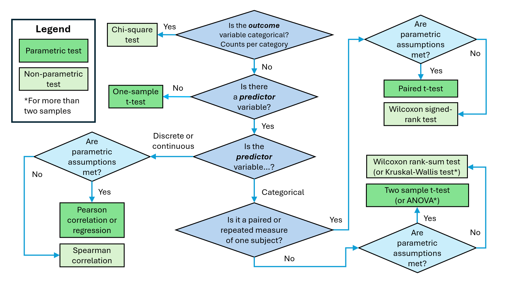

# (PART) Week 5 {-}

# Introduction {#intro_wk5}

The objective for this week's practical is to learn how to use two non-parametric tests to compare sample means. (Remember: last week we did the same thing with parametric t-tests.) The two tests are:

- the Wilcoxon rank-sum test (similar to a two sample t-test)
- the Wilcoxon signed-rank test (similar to a paired t-test)

We will also learn a third non-parametric test that compares the observed and expected frequencies of data in different categories:

- the chi-square test

We will be using three different data sets:

- Reproductive success (fledging) data from birds in two different years
- Number of insects visiting white and yellow flowers
- Frequency of sheep horn type

You will also learn how to export a sheet in an Excel file as a csv file. 

Download the Excel spreading from Moodle - BUT you do not need to upload it to the R server yet.

## Prepare a new script and load packages

As usual, you will want to start today’s practical with the following steps:

1. Open a new R script.
2. Save it under a sensible name (e.g. for today, something like `Week5Practical`) in your code folder.
3. Add in a header to explain what the script is.
4. Add in the code to load our three main packages/libraries.
5. Run the code the load the libraries.

For points 3 and 4, the easiest thing is to open your script from last week, copy and paste the relevant content, and then change the information that needs to be updated (e.g. the date and the practical number/topic in the header).

## Exporting csv files

Open the `Week5_data.xlsx` file in Excel.

To export the first dataset as a .csv file:

- Make sure you are looking at the first tab (`horn_data`).
- Select File > Save As.
- Change the file name to `horn_data`
- In the dropdown menu just below the file name, change the file type from "Excel Workbook (\*.xls)" to "CSV (Comma Delimited) (\*.csv)".
- Click Save.

Repeat this same process with the other two datasets / tabs (`flower_data` and `fledge_data`).

Upload all three files to your data folder on the R server.

## Read in the datasets

Read in all three of today's datasets. 

Store them as `flower_data`, `fledge_data` and `horn_data`, respectively. 

## General points about the tests

Parametric tests work by comparing the mean of your data to its spread (for example through the standard error). This type of test utilises all the information available in every data point. Think about how the mean is calculated; you add up all the values and divide by the number of data points. All the information is used.

You will need to use a non-parametric test if:

- you have a small sample size
- your outcome variable is categorical (e.g. colours), ordinal (e.g. ranks of vegetation abundance), or discrete data (e.g. counts of insects)
- your outcome variable is continuous, but it doesn't meet the assumptions of a parametric test (Normality) and there's not a good transformation or you don't want to use a transformation.

Non-parametric tests generally use the ranks of each data point. As a result, they compare medians rather than means. Therefore, they do not utilise all the information available, only the position of the data points (that is why they are less powerful). Think about how the median is calculated; the data points are put in order, and the middle value is selected. The actual values of the data points are not required to calculate the median.

Therefore, we have not used all the information available.


# Q1: Wilcoxon signed rank test {#wk5_Q1}


::: {.rmdquestion}
***Research Question:*** 

Is the reproductive success of breeding pairs of birds higher in their second year compared to their first year?
:::

For Question 1, we are going to compare the reproductive success of breeding pairs of birds in their first year of attempting to fledge a nest (2016) compared to their second year (2017). The birds in each breeding pair were identified by bands on their legs. The recorded data are the number of successfully fledged chicks for each pair in a given year.

Use the following questions to move through The Flow Chart™ and find the most appropriate statistical test to use.

::: {.rmdquestion}
***Questions:*** 

Looking at the research question and the data:

- What do you think the **outcome** variable is?
- What kind of variable is it (e.g. categorical, discrete, continuous)?
- What do you think the **predictor** variable is?
- What kind of variable is it (e.g. categorical, continuous)?


Looking at The Flow Chart™:

- How far could you navigate through The Flow Chart™ based on your answers above?
- Can you get all the way to a test? Why or why not?
:::


<div style="text-align: center;">

{width=100%}

</div>


## Check assumptions

The **Wilcoxon signed rank test** is the non-parametric test for paired data. 

This test doesn’t make any assumptions about the distribution of the data. You need at least 6 data pairs to run this test and they need to be at least ordinal data. This means it will work for numerical data that is discrete values (= whole numbers = integers), whilst paired t-tests require continuous data. This makes it a good option for count data, which are very common in ecology.

This test will also work for continuous data that does not meet the required assumptions for a parametric test (in this case, Normality of the differences in the paired data).


## Prepare the data

Before we can visualise the data, we need to subset it using the subset() function to make two new data frames, one for each year of attempted breeding.

The code below shows how you subsetted the penguin data last week.

```r
peng_data_adelie_male <- subset(peng_data_adelie, sex == "male")
```

::: {.rmdtip}
***Tip!*** Remember you must use `==` to logically compare column values to select the appropriate rows.
:::

Now visualise the data for each year with histograms using the `hist()` function.

::: {.rmdtip}
***Tips!***

Remember you can plot two figures side-by-side using: `par(mfrow = c(1,2))` - one row by 2 columns.

You may want to reset the original settings to one row and one column afterwards.
:::

::: {.rmdquestion}
***Questions:*** 

- What do the two distributions look like?
- Do they look Normal? 
- How many zero values are there? 
:::

Ecological count data are often **zero inflated**, meaning they have more zero values that would be expected from a normal distribution.

You can do a formal test for Normality if you are curious, but it is not necessary. These are discrete count data, so you should use a non-parametric test regardless.


## Hypotheses

Next, we write down our null and alternative hypotheses.

$\mathrm{H}_0$: The median number of fledged chicks is **not** significantly different between the bird pairs' first and second year of attempted breeding.

$\mathrm{H}_\mathrm{A}$: The median number of fledged chicks is significantly different between the bird pairs' first and second year of attempted breeding.

::: {.rmdtip}
***Tip!***

Reminder, that it is important that you are able to identify the null and alternative hypotheses when setting up a statistical test.

However, when you are writing up your results in a report, you do not need to explicitly state both of the hypotheses. (As you read more scientific papers, you'll notice they almost never do that.)

Instead, simply state what your research question or your actual hypothesis if you have one - whether your hypothesis is the null or the alternative from the statistical test perspective doesn't matter. 
:::


## Wilcoxon signed rank test

R uses the function `wilcox.test()` for both Wilcoxon tests:

- Wilcoxon signed rank tests for paired data (which we want here)
- Wilcoxon rank-sum test for non-paired data (which we will use in the next question)

For both tests, you need to provide both sets of data as the first two arguments. To get the signed ranks test, you also need to provide:

- the argument paired = TRUE
- the argument exact = FALSE (which tells it to do something called a "continuity correction")

Use the code below, replacing the names of the data frame and variables as appropriate for the specific data.

```r
# Wilcoxon signed rank test for paired data
wilcox.test(df_1$var, df_2$var,
			paired = TRUE, exact = FALSE)
```

::: {.rmdwarning}
***WARNING!*** You need to make sure that your matched pairs of data are in the **SAME ORDER** in both data sets, so that the pairs of data are correctly matched together. 
:::

::: {.rmdquestion}
***Question:*** Based on your Wilcoxon signed rank test results:

- Is P < 0.05?
- Should you reject or accept the null hypothesis?
- What do you conclude?
:::

Write down a formal sentence describing the outcome of the test in your script, with all of the appropriate information.
 
Write the sentence as a comment in your script, using the `#` symbol. You can hit Enter to write on multiple lines, but you will need to add a new `#` for each line.
 
Each sentence should include:

- the overall result of the research question (i.e. are the two groups different?)
- the *median* number of fledglings in year 1 and year 2
- the test statistic, V (sometimes also called T+)
- the p-value


The last two quantities are usually provided in brackets at the end of the sentence, like this: (V = 1.45, p = 0.34).

You will need to calculate the median using the `median()` function.


# Q2: Wilcoxon rank sum Test {#wk5_Q2}

::: {.rmdquestion}
***Research Question:*** 

Are insects more attracted by white or yellow flowers?
:::

We are going to be looking at a dataset collected during the Doñana field course to Spain. Students wanted to find out whether or not flower colour influenced their popularity with insects, and compared the numbering of insects landing on flowers of different colours (white and yellow). We are going to determine whether or not there is a significant difference between the colours.

::: {.rmdquestion}
***Questions:*** 

Looking at the research question and the data:

- What do you think the **outcome** variable is?
- What kind of variable is it (e.g. categorical, discrete, continuous)?
- What do you think the **predictor** variable is?
- What kind of variable is it (e.g. categorical, continuous)?


Looking at The Flow Chart™:

- How far could you navigate through The Flow Chart™ based on your answers above?
- Can you get all the way to a test? Why or why not?
:::


<div style="text-align: center;">

{width=100%}

</div>


## Check assumptions and prepare the data

The Wilcoxon rank-sum test doesn’t make any assumptions about the distribution of the data or about the variances. However:

- the two samples should have distributions with similar shapes (e.g. it is not suitable if one data set is positively skewed and the other is negatively skewed for example).

Visualise the data by making histograms and boxplots for each flower colour separately.

You will need to subset the data by colour first.

::: {.rmdquestion}
***Questions:*** 

Based on your histograms and boxplots:

- What do the two distributions look like?
- Do the white and yellow flower data look like they come from similar distributions?
:::

We could try transforming the data set, but because there are a lot of “zero” values, this could be tricky. In addition, it is a small data set, so a non-parametric test would be safer.


## Hypotheses

Next, we write down our null and alternative hypotheses.

$\mathrm{H}_0$: The median “insects per flower” is not significantly different for white and yellow flowers.

$\mathrm{H}_\mathrm{A}$: The median “insects per flower” is significantly different for white and yellow flowers.


## Wilcoxon rank sum test

As mentioned in the previous section, R uses the function `wilcox.test()` for both Wilcoxon tests.

For both tests, you need to provide both sets of data as the first two arguments. Additionally, for both tests you also need to provide:

- the argument exact = FALSE (which tells it to do something called a "continuity correction")

Because we are omitting the `paired = TRUE` argument, R will do the rank sum test for unpaired data instead of the signed rank test for paired data.

Use the code below, replacing the names of the data frames and variable as appropriate for the specific data. 

```r
# Wilcoxon rank-sum test for unpaired data
wilcox.test(df1$var,
			df2$var, exact = FALSE)
```

::: {.rmdquestion}
***Question:*** 

Based on your Wilcoxon rank sum test results:

- Is P < 0.05?
- Should you reject or accept the null hypothesis?
:::

Write down a formal sentence describing the outcome of the test as a comment in your script.
 
You sentence should include:

- the overall result of the research question (i.e. are the two groups different?)
- the **median** number of insects per flower for both colours of flower
- the test statistic, _W_ (sometimes also called _U_)
- the p-value

The last two quantities are usually provided in brackets at the end of the sentence.

::: {.rmdtip}
***Information*** 

The **Wilcoxon rank-sum test** is sometimes called the **Mann-Whitney U-test** in other statistical software.

Although the two tests use slightly different test statistics, both provide the same p-value and the test statistics can be calculated from each other using the equation below:

- W is the sum of all ranks
- $U=W−\frac{n(n+1)}{2}$
:::


# Q3: Chi-square test {#wk5_Q3}

::: {.rmdquestion}
***Research Question:*** 

Are all sheep horn types equally likely?
:::


A researcher is studying Soay sheep on St. Kilda. She observes that sheep have three different possibilities for horns: some sheep have large horns, some sheep have small horns, and some have no horns at all. She wants to know if all horn types are equally likely to occur, or if one is more common.

::: {.rmdquestion}
***Questions:*** 

Looking at the research question and the data:

- What do you think the **outcome** variable is?
- What kind of variable is it (e.g. categorical, discrete, continuous)?
- What do you think the **predictor** variable is?
- What kind of variable is it (e.g. categorical, continuous)?


Looking at The Flow Chart™:

- How far could you navigate through The Flow Chart™ based on your answers above?
- Can you get all the way to a test? Why or why not?
:::


<div style="text-align: center;">

{width=100%}

</div>


## Check assumptions

The chi-square test has very few assumptions. The key one is around the "expected" values (E).

- You must have a null hypothesis for the expected proportion of each category.
- However, these expectations can be very flexible and based on the specific processes generating your data. 

Here we have three possible values that we are comparing (large horns, small horns, no horns). First, let's assume that each type of horn is equally likely, such that the probably = 33.3% for each type. (We will change that assumption later.)

::: {.rmdquestion}
***Question:***  If we need to have a value of E > 5 for each horn type, what is the minimum number of sheep that we can observe?
:::

Examine the horn data using one of the methods you've been taught.

::: {.rmdquestion}
***Question:*** How many observations of sheep do we have? Can we proceed with the chi-square test?
:::

## Hypotheses

Next, we write down our null and alternative hypotheses.

$\mathrm{H}_0$: All types of horn are equally likely to occur.

$\mathrm{H}_\mathrm{A}$: There is a significant difference between the frequency of the different horn types.


## Doing a chi-square test

Before we can run the test, we need to do some processing to change the structure of our data.

Remember from lecture that chi-square test is based on comparing the observed (O) and expected (E) numbers in different categories.

When you looked at `data_horn`, you saw that the data observations (O) were provided as a list of individual sheep, and the type of horn that each sheep has. We need to turn that data into counts of sheep with each horn type.

Last week we used a function - `table()` - that does this type of tabulation, i.e turn a data frame of observations into a frequency table. The only argument that `table()` needs is a list of all the horn types (i.e. the `$horn_type` column).

Enter the code below into your script and run it. Examine the output in your console.

```r
# Get a frequency table of observed counts (O) for each horn type
horn_counts <- table(data_horn$horn_type)
print(horn_counts)
```

::: {.rmdquestion}
***Question:*** What do you notice about the order of the categories?
:::

Now that our data is formatted as a frequency table, we are ready to run a basic chi-square test where the null hypothesis is that all horn types are equally likely.

This general null hypotheses - all categories are equally likely - is the default for `chisq.test()` if you only provide the frequency table and no extra information.

```r
# Chi-square test for null hypothesis all horns are equally likely = 33.3%
chi2_horns_equal <- chisq.test(horn_counts)
print(chi2_horns_equal)
```

::: {.rmdquestion}
***Questions:***

Look at the degrees of freedom (df) in the results output.

- If degrees of freedom is usually n - 1, why do you think it is that number?
- What do you think counts as "n" for a chi-square test?
:::

::: {.rmdquestion}
***Questions:*** 

For a chi-square test based on equal frequencies of horn types: 

- Is P < 0.05?
- Should you reject or accept the null hypothesis?
:::

But what if we have a different null hypothesis? In some cases you will have more specific expected values (E), for example based on previous studies or some other process that you think is influencing the data.

Let's say there is another population of feral sheep on a nearby island with:

- 50% large horns
- 30% small horns
- 20% absent horns.

We can provide `chisq.test()` with a list of these expected frequencies (given as proportions with the argument `p =` ) in order to compare the two populations and determine if the sheep on St. Kilda have significantly different horn frequencies.

::: {.rmdwarning}
***WARNING!*** When R creates a frequency table, it puts the categories in alphabetical order, in this case: 1) "absent", 2) "large", and 3) "small."

You will need to provide the expected frequencies in the same order to make sure that is comparing the observed (O) and expected (E) values for the same categories.

Additionally, the proportions for all the categories must sum to exactly 1!!!
:::

Enter the code below into your script and run it. You will need to replace x, y, and z with the appropriate values in the second argument (based on the values from the nearby island and the order of the categories in our table).

```r
# Chi-square test for null hypothesis: 20% absent, 50% large, and 30% small
chi2_horns_2pops <- chisq.test(horn_counts, p = c(x, y, z))
print(chi2_horns_2pops)
```
::: {.rmdquestion}
***Questions:*** 

For a chi-square test comparing the frequencies of horn types on the two different islands: 

- Is P < 0.05?
- Should you reject or accept the null hypothesis?
:::

Write down a formal sentence describing the outcome of the test as a comment in your script.
 
You sentence should include:

- the overall result of the research question
- the numbers of sheep in each category
- the test statistic, χ2
- the degrees of freedom
- the p-value

The last three quantities are usually provided in brackets at the end of the sentence. 


# Q3: Chi-square test by hand

Sometimes it can hard to get our data into the exactly right format for R's `chisq.test()` function - a frequency table. You may find yourself in a position where you need to calculate chi-square by hand, either in R or Excel.

This page will show you how to do that, and help you understand the process of the chi-square test more deeply.

Remember that for the chi-square test, our test statistic (χ2, the greek letter "chi" squared), is calculated as:

$$ \chi = \sum{\frac{(O-E)^2}{E}}$$

This is not too difficult to calculate by hand.

We'll start by turning our table into a proper data frame - the main data structure with observations (rows) of variables (columns) that R uses. Data frames can do specific tasks that tables can't (e.g. refer to columns with $, add new columns, etc.).

Use the `data.frame()` function to convert the table to a data frame and store it as the variable `horn_counts_df`, as shown below. Examine both formats and note how they differ.

```r
# Convert horn count frequency table to a data frame
horn_counts_df <- data.frame(horn_counts)
print(horn_counts_df)
print(horn_counts)
```
Now that we have our observed values (O) in a data frame, we need to calculate the expected number of sheep with every horn type (E).

::: {.rmdwarning}
***WARNING!*** 

The `chisq.test()` function needs the expected frequencies of horns as proportions that add up to 1. 

However, to do the calculations by hand, we will need to calculate the actual expected number of sheep with each horn type.
:::

Remember, our original null hypothesis is that all horn types were equally likely. This means our expected value for all horn types should equal the total number of sheep divided by 3.

Type the following code into your script, but replacing col_x with the appropriate column name. This code:

- Sums the horn counts to find the total number of sheep
- Divides by 3 to find the expected number of sheep with each horny type, assuming they are all equal.

Modify the code below to match the proper column name and run it. 

```r
# Calculate expected number for each horn type
horn_E <- sum(horn_counts_df$col_x)/3
print(horn_E)
```
::: {.rmdquestion}
***Question:*** How many sheep do we expect to have each type of horn?
:::

Now we know our expected numbers of sheep with each horn type, but we need to add them to the `horn_counts_df` data frame.

We'll create a new column in `horn_counts_df`, and give R a list of the values we want to fill it.

Since we want to add the same value for all horn types, we can use the function `rep()` - which stands for "repeat" - to repeat our predicted value three times, one for each row that we want to fill it in.

The `rep()` function takes two arguments, in order:

- The value you want to repeat
- The number of times you want it repeated

Take the line of code you wrote to calculate the expected number of sheep with each horn and:

- Put the calculation inside the `rep()` function, and add the number of repeats as the second argument 
- Store it as a new column, expected, in the `horn_counts` data frame

```r
# Create a new column with the expected number for each horn type
horn_counts_df$expected <- rep(horn_E, 3)
print(horn_counts_df)
```

Run the code. Inspect your `horn_counts_df` data frame to make sure it worked.

Now create a new column (`OE2E`) with the quantity $\frac{(O-E)^2}{E}$ calculated for each row. You will *do the maths with the columns in the data frame*, just like you did before to transform the tree size data, and to subtract the upstream and downstream conductivity.

```r
# Calculate (O-E)^2/E for each horn type
horn_counts_df$OE2E <- <INSERT CALCULATION HERE>
print(horn_counts_df)
```
Now we just need to sum the `OE2E` column to calculate our χ2 test statistic value.

```r
# Sum OE2E column to get X2 test statistic
horn_X2 <- sum(horn_counts_df$OE2E)
print(horn_X2)
```
::: {.rmdquestion}
***Question:*** Does the chi-square statistic here match the results from the `chisq.test()` output?
:::

To do the test by hand, we also need to determine the degrees of freedom. We have 3 categories. We have used 1 piece of information to generate our expected values (the number of categories), so here df = 3-1 = 2.

The final step of the test is to calculate the critical value of χ2 to compare our test statistic to. To do so, we use the function `qchisq()` which gives us information about the distribution of the χ^2 test statistic.

This function needs the following arguments:

- The α value for significance, given as `p = `
- The degrees of freedom, given as `df = `
- The final argument `lower.tail = FALSE`, because the upper tail will give us the correct value.

```r
# Get the critical value of chi2
qchisq(p = 0.05, df = 2, lower.tail = FALSE)
```

::: {.rmdquestion}
***Questions:*** 

- Is our test statistic larger than our critical threshold value?
- Does this mean we accept or reject the null hypothesis?
- Does that agree with the previous results from the automated test?
:::

We can also calculate the exact P-value from the χ^2 test statistic with the function `pchisq()`.

```r
# Get the P-value for chi2
pchisq(q = horn_X2, df = 2, lower.tail = FALSE)
```

::: {.rmdquestion}
***Question:*** Does this P-value match the results from the `chisq.test()` function?
:::


# Making graphs and tidying up {#tidyup_wk5}

## Making graphs

Create a graph for each question to illustrate your conclusions.

This week's graphs are easier to make in R than last week's graphs, because for data analysed with non-parametric tests, you don't have to calculate means and SE. You can just plot the original data itself!

::: {.rmdwarning}

***WARNING!***: Plotting means and standard errors is not appropriate for non-Normally distributed data!!!

For reporting data analysed with Wilcoxon tests, it is best to make boxplots (which provide medians, IQR, etc.) to show the median and give a sense of the shape of the distribution.

For reporting data analysed with a chi-square test, it is best to make a column plot of the counts - no error bars are needed because all your data are pooled to generate the counts/frequencies.
:::

## Plotting frequency or count data with `ggplot()`

To plot data for a chi-square test, you will need to get your frequency table data formatted as a data frame (as shown in chapter 27 - you should have already done this).

Then you can adapt the code for one of the column plots that you made last week. (Remember to remove any error bars!)

If you want, you can add a horizontal line layer with `geom_hline()` to show the expected value if all groups were equal. 

You will need to add a layer to your plot based on the example below. 

```r
  geom_hline(yintercept = y_val, linetype = "dotted", linewidth = 1) +
```

::: {.rmdtip}
***Tip!*** If you ever want to add a vertical line to a plot, the function is (unsurprisingly) `geom_vline()`.
:::


## Tidying up 

Now it's time to tidy up and save your R script. 

As always, you will want to:

- Make sure that your code is sufficiently commented, so that someone else (or you later on!) can understand what you did.
- Delete any spare lines of code that you don't need anymore (e.g. for testing something that didn't work right away).

## Updating your R cheatsheet

A reminder that I **strongly** recommend creating a set of notes where you keep track of all the bits and bobs of R that you've learned.

Today we've added two functions:


### General / data analysis

- `data.frame()`
- `rep()`
- `sum()`

## Statistical tests

- `chisq.test()`
- `wilcox.test()`

## Other probability functions

- `qchisq()`
- `pchisq()`

