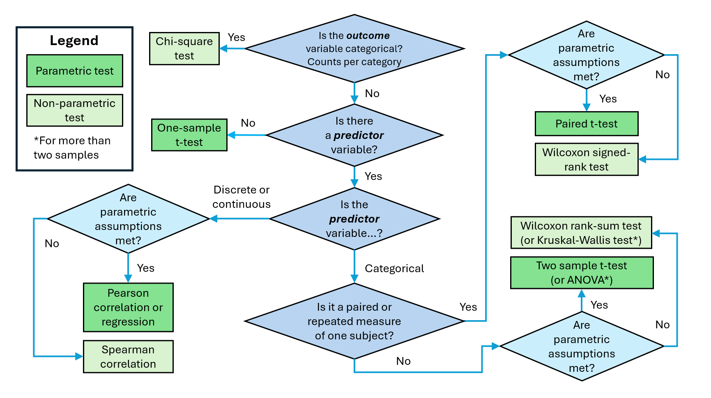
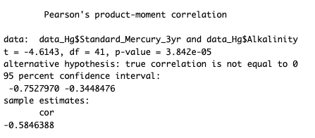
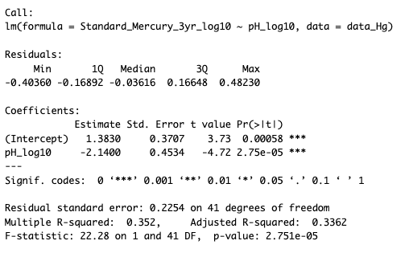
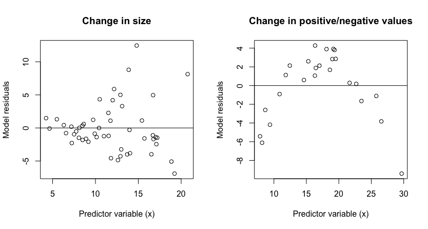
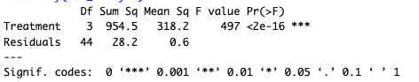

# (PART) Week 6 {-}

# Introduction {#intro_wk6}

The objective for this week's workbook is to learn when and how to use a variety of new analyses.

Three of the analyses are used when you have a continuous predictor variable:

- *Pearson correlation* (parametric test)
- *Spearman correlation* (non-parametric test)
- *linear regression* (parametric test)

Two of the analyses are used to extend the tests we've previously done to compare means (t-tests and Wilcoxon tests) to more than two samples (i.e. categorical variables with more than two treatments/groups).

- *One-way ANOVA* (parametric test)
- *Kruskal-Wallis* (non-parametric test)

In both cases, the test does not tell you _which_ samples are significantly different, only that there is a significant difference between any of your samples.

This means you will need to do a *post-hoc test* (either Tukey Honestly Significant Difference test or Wilcoxon rank sum test) to determine which samples are significantly different from each other. (Post hoc means "after this" in Latin.)

## Datasets

We are going to use one old dataset and three new datasets:

- _Penguin data_ - The Palmer penguin dataset.
- _Insect data_- The full dataset of insects visiting flowers collected from the Doñana field course (we looked at part of it last week).
- _Algae data_ - Data on algal growth over time in lake water with different nutrients added. (Some of you may remember this data set from LEC143 Aquatic Ecology.)
- _Prevalence data_ - data on the prevalence of zooplankton infections from lakes located at three elevations.

Download the new datasets for this week from Moodle. They are be provided in one Excel file.

The Excel file contains three tabs of data and one tab of metadata that provides additional information about the datasets.

You will need to export the three individual sheets to .csv files. If you don't remember how to do so, instructions can be found in [last week's introduction](#exportcsv).

::: {.rmdwarning}
***Warning!*** There is something a little tricky about today's data! You need to make some minor modifications to some of the sheets before they are ready to export as csv files.
:::

Upload all of the csv files to your data folder on the R server.

## Prepare a new script and load packages

As usual, you will want to start today’s practical with the following steps:

1. Open a new R script.
2. Save it under a sensible name (e.g. for today, something like `Week6Practical`) in your code folder.
3. Add in a header to explain what the script is.
4. Add in the code to load our three main packages/libraries.
5. Run the code the load the libraries.

For points 3 and 4, the easiest thing is to open your script from last week, copy and paste the relevant content, and then change the information that needs to be updated (e.g. the date and the practical number/topic in the header).

## Read in the datasets

Read in all of today's datasets. 

Store them as `peng_data`, `insect_data`, `algae_data` and `prev_data`, respectively.

## Model notation in R

So far we have mostly been doing statistical tests where we analyse one sample or two samples with a categorical predictor variable.

For these tests, we could provide our data to the test function (`t.test()` or `wilcoxon.test()`) with each sample formatted as a list of numbers. (Or for chi-square, we gave it the total counts for each category.)

However, now that we are doing more complicated tests - with continuous predictor variables or with more than two categories - we need to learn how to use write a model formula in R.

### Writing model formulas in R

In R, the formulas for statistical models are generally written using the `~` symbol (called a "tilde").

A simple model with soil carbon as the outcome variable and tree density as the predictor variable might look like this:

```r
Soil_carbon_conc ~ tree_density
```

If you were reading the model formula aloud, you would say:

- "soil carbon concentration *is predicted by* tree density"

This week we will use this formula notation to write the models for linear regression and make some diagnostic x-y scatter plots.

Correlations can be run using the same list-of-numbers method as we used previously for `t.test()` and `wilcox.text()`.


# Q1: Pearson Correlation {#wk6_Q1}

::: {.rmdquestion}
***Research Question:*** 

Is there a relationship between body morphology and body mass in female Adélie penguins?
:::

Imagine that scientists are considering setting up a series of underwater cameras on the Palmer Archipelago in Antarctica. They want to use the existing data to see if they can use the resulting images to estimate penguin body mass, which is much cheaper and easier than catching the penguins and weighing them.  

We will use the the existing dataset to test the feasibility of this plan.

There are three morphological metrics in the dataset:

- Bill length
- Bill depth
- Flipper length

We will focus on just female Adélie penguins because we know that there is substantial variation based on species and sex. 

::: {.rmdquestion}
***Questions:*** 

Looking at the research question and the data:

- What do you think the **outcome** variable is?
- What kind of variable is it (e.g. categorical, discrete, continuous)?
- What do you think the **predictor** variable is?
- What kind of variable is it (e.g. categorical, continuous)?


Looking at The Flow Chart™:

- How far could you navigate through The Flow Chart™ based on your answers above?
- Can you get all the way to a test? Why or why not?
:::


<div style="text-align: center;">

{width=100%}

</div>


## Prepare the data and Check assumptions

First, we will need to subset the specific data we want (female Adélie) from the larger dataset.

::: {.rmdtip}
***Tips!*** 

Remember you must use `==` to logically compare column values to select the appropriate rows.

You can use the `&` symbol to subset for values in two different columns at the same time.
:::

```r
mydf_sub <- subset(mydf, col1 == "value_A" & col2 == "value_B")
```

Then, we need to check whether or not the underlying assumptions hold before we can start doing correlation analysis.

There are two types of correlation analysis, parametric and non-parametric. The more powerful, parametric version assumes that the data are Normally-distributed, although it is relatively robust if the data aren’t perfectly Normal.

Use your function `examine_norm()` from weeks 3 and 4 to determine whether or not the data four all four variables of interest (the three morphological measurements and body mass) are Normally-distributed.

::: {.rmdquestion}
***Questions:*** 

- Are any of the variables Normally-distributed? 
- How big are the samples? Can we proceed with a correlation test?
- Do we want body mass on the x-axis or y-axis? Why?
:::

You can make a simple x-y scatter plot in R using the `plot()` function. They are not as pretty as figures made with `ggplot()` but are easier for simple figures to examine your data (just like `hist()` and `boxplot()`).

You need to provide the `plot()` function with two lists of numbers (one for your outcome variable and one for your predictor variable) using the model formula - e.g. `y ~ x`. There are two ways to do this:

- Refer to each column directly with $, i.e. the way we have been doing it previously, as `df$y ~ df$x`
- If both columns are from the same data frame, it can be easier to provide the data frame with the `data =` argument, and then just use the column names in the model formula

For example, the code below will make two identical plots with `pred_var` on the x-axis and `outcome_var` y-axis.

```r
# Two ways to provide the data to make the same scatter plot
plot(mydf$outcome_var ~ mydf$pred_var)
plot(outcome_var ~ pred_var, data = mydf)
```
::: {.rmdquestion}
***Questions:*** 

Looking at the scatter plots.

- Do any of them suggest that there might be a linear relationship between the variables?
- Do any of them suggest there might be a non-linear relationship between the variables?
:::

::: {.rmdwarning}
***Warning!*** Remember: it is essential to create a scatter plot first, before you start doing correlation or regression tests!
:::

::: {.rmdquestion}
***Question:*** Why is it essential to create a scatter plot first?
:::


## Hypotheses

Next, we write down our null and alternative hypotheses.

$\mathrm{H}_0$:  There is *no* linear correlation between body mass and (X, Y, Z).

$\mathrm{H}_\mathrm{A}$: There is a linear correlation between body mass and (X, Y, Z).

where X, Y, and Z are bill length, bill depth, and flipper length.


## Pearson correlation test

In R, the function `cor()` will calculate a correlation coefficient between two variables.

However, we want to perform a full correlation test (that also provides 95% CIs and P-values), so we will use the function `cor.test()` instead. 

For both of these functions:

- Provide the variables as the first two arguments, formatted as lists of numbers (i.e. the columns in your data frame)
- The default calculation is the *parametric Pearson correlation*, which assumes your data are Normally-distributed. (Parametric and Pearson both start with P, which can help you to remember.)
- You can add an optional third argument, `method = "spearman"`, to calculate the non-parametric Spearman rank correlation for non-Normally distributed data.

::: {.rmdwarning}
***Warning!*** In the psych package there is a function called `corr.test()` - with two rs instead of one r - DO NOT ACCIDENTALLY USE THIS TEST INSTEAD!
:::

Calculate the Pearson correlation between body mass and each of the three morphological variables.

The output will look like the image below.

<div style="text-align: center;">



</div>

The most important things to look at are:

- The P-value
- The correlation coefficient (_r_) is which listed here as "cor", and its 95% confidence intervals.

If the 95% CIs do not include zero, the P-value will be significant.


::: {.rmdquestion}
***Question:*** Based on your correlation test results:

- Which parameter has the stronget relationship with body mass (i.e. has the biggest _r_ value?)
:::

Write down a formal sentence or two describing the outcome of the correlation tests. This should include:

- the overall result of the research question(s)
- the name of the test(s)
- the test statistic, t
- the degrees of freedom, df
- the correlation coefficient, r
- the P-value


# Q2: Linear regression {#wk6_Q2}

::: {.rmdquestion}
***Research Question:*** 

Is there a relationship between bill depth and body mass in female Adélie penguins?
:::

We've identified which variable we want to move forward with. However, before we go any farther, we need to think about the difference between correlation and regression.

::: {.rmdquestion}
***Question:*** We have just done a correlation test on this data set. Can we also do a regression? Why or why not?
:::

We have a specific motivation for predicted body mass based on bill size, so we have a good reason to go ahead with a regression.

There is also a good mechanistic reason to think that bigger penguins might weigh more. 

## Hypotheses

Next, we write down our null and alternative hypotheses.

$\mathrm{H}_0$: There is *no* significant linear relationship between bill depth and body mass.

$\mathrm{H}_\mathrm{A}$: There is a significant linear relationship between bill depth and body mass.


## Linear regression

The function that performs linear regression in R is called `lm()`, which stands for "linear model".

- We will use `lm()` to run a linear regression with one continuous predictor variable.
- However, `lm()` is a very flexible and powerful function that you can use to fit other types of models as well. (We will use it later for the ANOVA.)

To use `lm()`, you need to give it two lists of numbers (i.e. outcome and predictor variables) using a *model formula*. Just like for `plot()`, you can refer to the columns directly with $ or give the data frame using the data = argument.

For example, the code below runs two identical linear regressions:

```r
# Two ways to fit the same linear regression
lm(outcome_var ~ predictor_var, data = mydf)
lm(mydf$outcome_var ~ mydf$predictor_var)
```

Run a linear regression substituting in your data frame and variable names. 

::: {.rmdquestion}
***Question:*** What output do you see in the Console?
:::

The basic output that gets printed is:

- the code we ran
- the two coefficients that define the regression line through our data (i.e. the intercept and the slope)

However, we want more than just that. We also want:

- a P-value to tell us if the effect of of our predictor is significant
- an $R^2$ value to tell us how well our predictor variable predicts the variation in the outcome variable
- the 95% CIs for both of the coefficients that define our best fit line.

In order to get these extra details, we need to store our linear model output as an object, and then use two functions to give us the information:

- `summary()` - provides a P-value and an $R^2$ value for a model
- `confint()` - provides 95% CIs for model coefficients

```r
# Linear regression + summary of output + 95% CIs
lm_out <- lm(outcome_var ~ predictor_var, data = mydf)
summary(lm_out)
confint(lm_out)
```

Modify your `lm()` code to store it as an object, and then use `summary()` and `confint()` on the model object. Run the code.

::: {.rmdquestion}
***Question:*** Now what output do you see in the Console?
:::

<div style="text-align: center;">

{width=100%}

</div>


This output has a lot of information! 

- The code you used to make the model.
- Summary statistics on the model residuals - these are the differences between each observed data point and it's predicted value from the model. (We will talk more about these in the next section.)
- Information on the model coefficients, i.e. the slope and intercept for the regression line. The slope is named for the predictor variable that it gets multiplied by. R provides the coefficient itself (Estimate), the standard error of the coefficient, a t-value test statistic, and a P-value that the coefficient is significantly different from zero (`Pr(>|t|`), the probability of observing a t statistic this extreme by random chance). Depending on the significance of the P-value, there may or may not be asterisks indicating how significant it is.
- Information about the overall model: residual standard error, degrees of freedom, two versions of $R^2$, an F test statistic for the full model, and a p-value for the full model (which will match the P-value for the slope if you have only one predictor variable).

You can ignore much of this information. The main things that you need to pay attention to are:

- The estimates of the model coefficients (i.e. the equation for your regression line)
- The P-value for the slope coefficient / the whole model (they are the same for a one-predictor linear regression).
- The adjusted $R^2$ value - remember how this is related to r, the correlation coefficient!

However, when you report your results as a sentence you will also want to note:

- a test statistic (either t for the predictor variable or F for the full model - either one is okay)
- the degrees of freedom, df

::: {.rmdtip}
***Information:***

The adjusted $R^2$ value is modified to account for the number of predictors in your model.

The more predictors you have, the more different it will be from the basic $R^2$.

We could write down theses statistics now since we've gotten them from the R output - but there are few other checks that we need to do first. 
:::

## Evaluating a linear regression model

The final step for fitting a linear regression model is to analyse the residuals, which are the differences between each observed data point and its predicted value from the model.
For the linear regression model assumptions to be valid, the residuals:

- should be Normally distributed.
- should not change their pattern with the value of the predictor variable (i.e. become much bigger/smaller or more likely to be positive/negative as you move along the x-axis).

You can extract the residuals from a model with the function `resid()`.

Type the following code into your script - substituting your model name - and run it.

```r
# Calculate residuals of the linear regression
resid(lm_out)
```

::: {.rmdquestion}
***Question:*** What output do you see in the Console?
:::

R has printed a list of numbers containing all the differences between the predicted value and each observed point in our data set. Conveniently, that is the exactly data format that the `examine_norm()` function uses.

Use your function `examine_norm()` to examine the residuals of the model.

::: {.rmdquestion}
***Question:*** Do the residuals look Normally distributed? Do they pass the formal tests? 
:::

Now we need to plot the residuals and see if they change substantially along with values of the predictor variable.

As mentioned above, the residuals should not change their pattern with the value of the predictor variable. The figures below show examples of what you do NOT want to see!

- In the left panel, the residuals get bigger as x gets bigger.
- In the right panel, the residuals are positive in the middle and negative on the ends.

<div style="text-align: center;">

{width=100%}

</div>

Just like we did at the beginning, when we were making our first scatter plots, we will use the `plot()` function and give it our x values first and y values second.

This time, we will also a function `abline()` to add a horizontal line at y = 0, so it's obvious which values are positive and which are negative. The first argument (`a = 0`) is the intercept and the second argument (b = 0) is the slope.

Modify the code below to plot the residuals for your model over your predictor variable.

```r
# Plot the model residuals and the predictor variable
#    add a horizontal line at y = 0
plot(resid(lm_out) ~ mydf$predictor_var)
abline(a = 0, b = 0)
```

::: {.rmdquestion}
***Question:*** Do the residuals look like they change substantially along with the predictor variable? 
:::

If the residuals of the model are not Normally distributed, or their pattern changes over the predictor variable, you may have a nonlinear relationship between your variables!

This means your linear regression model is probably not appropriate for describing your data, and is why it so important to make a scatter plot of your data first!!!

If the residuals are normal and the plot looks okay, then you are ready to report your results. You can re-run the `summary()` and `confint()` code to re-print the important values at the bottom of your console (or you can scroll up to find them).


::: {.rmdquestion}
***Question:*** 

Based on your regression analysis results:

- Is P < 0.05?
- Should you reject or accept the null hypothesis?
:::

Write down a formal sentence describing the outcome of the test as a comment in your script.
 
You sentence should include:

- the overall result of the research question
- the name of the test
- the slope and intercept coefficients, with 95% CIs
- the adjusted $R^2$-value
- a test statistic, either t or F
- the degrees of freedom, df
- the P-value

Most of these quantities are usually provided in parentheses at the end of the sentence.


# Q3: Spearman correlation {#wk6_Q3}

::: {.rmdquestion}
***Research Question:*** 
  
Is the number of insects observed related to the number of flowers?
:::
  
We will now turn to the insect data from the Doñana field course. Last week you used an edited version of the data set. This week we'll use the full data set.

We want to test to find out if the number of insects observed is related to the number of flowers in the study area.

::: {.rmdquestion}
***Questions:*** 

Looking at the research question and the data:

- What do you think the **outcome** variable is?
- What kind of variable is it (e.g. categorical, discrete, continuous)?
- What do you think the **predictor** variable is?
- What kind of variable is it (e.g. categorical, continuous)?


Looking at The Flow Chart™:

- How far could you navigate through The Flow Chart™ based on your answers above?
- Can you get all the way to a test? Why or why not?
:::


<div style="text-align: center;">

{width=100%}

</div>

Here, we need to do a non-parametric test (Spearman’s rank correlation), because our data are discrete rather than continuous.


## Examine the data

First we need to draw a scatter plot of our data.

We could use the basic `plot()` function to get a quick look at it, like we did for the penguin data.

```r
# Make a scatter plot
plot(Total_insects ~ Flowers, data = data_insect)
```

However, we know that: 1) our data have observations from both yellow and white flowers, and 2) based on last week's practical, there is a significant difference between the insects per flower on white and yellow flowers (Wilcoxon rank sum test: W = 67, p = 0.018).

This means we should probably plot our data so we can see which points come from each colour of flower, since they may show different relationships. For that we'll have to use our fancy `ggplot()` plotting method instead.

Start by filling in our scatter plot template with the correct data frame and variable names.

```r
figure_1 <- ggplot(data = data_df, aes(x = predictor, y = response)) +
	geom_point() +
	theme_classic() +
	labs(x = "x-axis label (units)", y = "y-axis label (units)") +
	theme(axis.title = element_text(size = 14),
		  axis.text = element_text(size = 11))
print(figure_1)
```

Next, we are going to add another argument to the `aes()` function: `colour = Flower_colour`.

::: {.rmdtip}
Because we are adding it to the `aes() function` - where we tell ggplot what our x and y variables are - it will group the data for plotting, make the points for each group different colours, and automatically add a legend.
:::

Your `aes()` function (within all the code for plotting the figure) should look like this now:

```r
aes(x = Flowers, y = Total_insects, colour = Flower_colour)) +
```

::: {.rmdquestion}
***Questions:*** Looking at the scatter plot:

- Do you think there might be an underlying correlation?
- Does it look like there are different patterns for white and yellow flowers?
:::

It looks like there are indeed two different patterns for different colours of flower, and that the relationship for white flowers is stronger than the relationship for yellow flowers.
 
Let's change our focus to white flowers only. This means we'll need to use the `subset()` function to subset our data to isolate the data for white flowers.
 
## Hypotheses

Next, we write down our null and alternative hypotheses.

$\mathrm{H}_0$: The number of insects is *not* related to the number of white flowers.

$\mathrm{H}_\mathrm{A}$: The number of insects is related to the number of white flowers.

## Spearman rank correlation

Remember that we will use the same function as before - `cor.test()` - but add a third argument (`method = "spearman"`) to tell it to do a non-parametric Spearman rank correlation test instead of the parametric Pearson correlation test.

Run the test.

The output is quite similar to the previous output for the Pearson correlation, except:

- The correlation coefficient is called ρ or rho (similar to the r for a Pearson correlation, but different because it is calculated from ranks).
- The test statistic is called S
- There is no way to calculate confidence intervals since we cannot assume a Normal distribution.

::: {.rmdquestion}
***Question:*** Based on your Spearman correlation test results:

- Is P < 0.05?
- Should you reject or accept the null hypothesis? 
:::

You should be able to create a graph of your results by modifying the code from section 5.1. You will need to:

    Change the data to the subsetted white flower data.
    Remove the colour = Flower_colour argument from aes() (and the comma preceding it).

Write down a formal sentence describing the outcome of the test. This should include:

- the overall result of the research question
- the name of the test
- the correlation coefficient, rho or ρ
- the test statistic, S
- the P-value

The last three quantities are usually provided in parentheses at the end of the sentence.


# Q4: One-way ANOVA

::: {.rmdquestion}
***Research Question:*** 
  
Is there a significant difference in the algal growth when different nutrients (N, P, NP, or none) are added to water from the north basin of Lake Windermere?
:::
  
Algal bio-assays are a common way to measure nutrient limitation in aquatic water bodies. In these experiments:
  
- Water containing algae is sampled from the body of water
- The water is divided into different samples. 
- One sample is reserved as a control and is not modified. The other samples are supplemented with various nutrients, usually nitrogen (+N), phosphorus (+P), and a combination of both (+NP).
- All the samples are exposed to light for several days or weeks so the algae can grow.
- Algal growth is measured as the fluorescence of chlorophyll-a in the water sample.

If either nitrogen or phosphorus is limiting algal growth, the algae should grow faster than the control when that specific nutrient is added. If both nutrients are co-limiting, then only the combined treatment (+NP) will have faster growth than the control.

::: {.rmdquestion}
***Questions:*** 
  
Looking at the research question and the data:
  
- What do you think the **outcome** variable is?
- What kind of variable is it (e.g. categorical, discrete, continuous)?
- What do you think the **predictor** variable is?
- What kind of variable is it (e.g. categorical, continuous)?
  
  
Looking at The Flow Chart™:
  
- How far could you navigate through The Flow Chart™ based on your answers above?
- Can you get all the way to a test? Why or why not?
:::

<div style="text-align: center;">
  
{width=100%}

</div>
  
## Prepare the data
  
Algae are single celled organisms that grow exponentially. When each cell divides it produces two cells, so the number of cells doubles each generation. For this reason, data of algal growth are usually log-transformed, which makes exponential differences into linear differences.

Log10 transform the chlorophyll-a variable, using the usual method (i.e. create a new column with the results of a mathematical operation on the original chlorophyll-a column). (Remember we did this in week 3.)

You can assume that these log-transformed data are Normally distributed.

Additionally, we need to subset our data in two ways:
  
- We only need to compare means from the final day of the experiment (day 21).
- We only need the data from water collected from the Windermere North basin, not from the other three lake basins in the larger experiment.

Remember that you can subset data by multiple columns using the `&` symbol.

## Hypotheses

Next, we write down our null and alternative hypotheses.

$\mathrm{H}_0$: There are *no* significant differences between the log(Chla) concentrations in any of the nutrient addition treatments (i.e. there are NO limiting nutrients).

$\mathrm{H}_\mathrm{A}$: There is a significant difference between the log(Chla) concentrations in some of the nutrient addition treatments (i.e. there is at least one limiting nutrient).

## One-way ANOVA

The function for an ANOVA test in R is `aov()`. (Remember that ANOVA stands for "analysis of variance.")

Just like Q2 with the linear regression model:
  
- We need to specify the ANOVA model using R's model formula notation, where `Y ~ X` means "Y is predicted by X".
- We need to use the `summary()` function to look at our results.

Modify the following code in your script, replacing the arguments with the appropriate variable names from your data. Run it.

```r
aov_WN21 <- aov(outcome_var ~ predictor_var, data = mydf)
summary(aov_WN21)
```

The output should look something like the image below (but with different numbers because your model is using different data).

<div style="text-align: center;">
  


</div>
  
::: {.rmdquestion}
***Question:*** 
  
  Based on your ANOVA analysis results:
  
  - Is P < 0.05?
  - Should you reject or accept the null hypothesis?
:::
  
We will wait to write a formal sentence about our results until we do the post-hoc test.

## Tukey HSD test

The ANOVA tells us that there is a significant difference, but not which samples are significantly different. For that we need a post-hoc test. The most common post-hoc test for Normally distributed data is Tukey's Honestly Significant Different test, usually abbreviated Tukey's HSD test.

In R, the function for Tukey's HSD test is `TukeyHSD()`. It only needs one argument: the statistical model (in this case, our stored ANOVA test). 

The Tukey's HSD test will directly display the results - we don't need to use `summary()`.

Run Tukey's HSD test on your ANOVA test object.

::: {.rmdquestion}
***Question:*** 
  
Based on your Tukey's HSD test results:
  
- Which nutrient addition treatments are significantly different?
- Which nutrient is limiting algal growth in the Windermere North lake basin?
:::
  
Write down a formal sentence (or two) describing the outcome of the ANOVA and Tukey HSD tests. This should include:
  
- the result of the specific research question (i.e. in terms of the statistical tests: both the main hypotheses and which treatments are different)
- the names of the tests
- the F test statistic for the ANOVA test
- the P-values for both tests
- the implications for the bigger research question (i.e. in terms of nutrient limitation)

The test statistic and P-values are usually provided in parentheses at the end of a sentence.


# Q5: Kruskal-Wallis test

::: {.rmdquestion}
***Research Question:*** 
  
  Is there a significant difference in the infection prevalence of _Daphnia_ zooplankton populations sampled at different elevations?
:::
  
Infection prevalence is the *proportion* of individuals in a population that are infected by a pathogen.

- Prevalence always varies between 0 and 1.
- Because its values are restricted, prevalence is rarely Normally distributed and generally should not be analysed with a statistical test that assumes Normality.

These data on infection prevalence of the fungal pathogen Metschnikowia bicupidata in Daphnia zooplankton hosts were collected from lakes located at three different elevations.

- There were 12 lakes sampled at each elevation (low, middle, and high).
- In each lake, 100 Daphnia were diagnosed under a microscope to determine the infection prevalence.

*Assume that you will use a non-parametric test for these data based on the type of data.*
  
::: {.rmdquestion}
***Questions:*** 
  
Looking at the research question and the data:
  
- What do you think the **outcome** variable is?
- What kind of variable is it (e.g. categorical, discrete, continuous)?
- What do you think the **predictor** variable is?
- What kind of variable is it (e.g. categorical, continuous)?
  
  
Looking at The Flow Chart™:
  
- How far could you navigate through The Flow Chart™ based on your answers above?
- Can you get all the way to a test? Why or why not?
:::
  
  
<div style="text-align: center;">
  
{width=100%}

</div>

## Hypotheses
  
Next, we write down our null and alternative hypotheses.

$\mathrm{H}_0$: There are *no* significant differences in the prevalence of fungal infections in Daphnia from lakes at different elevations.

$\mathrm{H}_\mathrm{A}$: There is a significant difference in the prevalence of fungal infection in Daphnia from lakes at different elevations.

## Kruskall-Wallis test

In R, the function for the Kruskal-Wallis test is `kruskal.test()`.

Just like for the ANOVA, we will use R model formula notation and provide the data frame with the argument `data = `.

However, the results will print directly, so we do not need to use the `summary()` function.

Run the Kruskal-Wallis test on the prevalence data.

::: {.rmdquestion}
***Question:*** 
  
Based on your Kruskall-Wallis test results:
  
- Is P < 0.05?
- Should you reject or accept the null hypothesis?
:::
  
We will wait to write a formal sentence about our results until we do the post-hoc test.

## Wilcoxon rank sum test

This time we need a non-parametric post-hoc test that is appropriate for non-Normally distributed data.

The easiest one in R (because we don't need to install any extra packages) is the Wilcoxon rank sum test that you used in week 7 to compare two samples.

Remember that for the Wilcoxon rank sum test - run using the function `wilcox.test()` - you need to provide the data as two lists of numbers. 

- *This means you will have to subset the data by elevation in order to provide each sample separately.*
  
Subset the prevalence data into three data frames, one for each elevation category.

You will need to run the Wilcoxon rank sum test on all three combinations of elevation:
  
- low vs. middle
- low vs. high
- middle vs. high

Run the Wilcoxon rank sum test three times, on each pair of samples.

::: {.rmdquestion}
***Question:*** 
  
Based on your Wilcox rank sum test results:
  
- Which elevation treatments are significantly different?
:::
  
Write down a formal sentence (or two) describing the outcome of the Kruskall-Wallis and Wilcoxon rank sum tests. This should include:
  
- the result of the research questions (main hypotheses and which treatments are different)
- the names of the tests
- the test statistic for the tests
- the P-values for the tests

The test statistic and P-values are usually provided in parentheses at the end of a sentence.


# Making graphs and tidying up {#tidyup_wk6}

## Making graphs

This practical was longer than previous practicals, so you may need to create the graphs on your own time.

The only new thing that you need to know for the graphs this week is how to add a trendline to a scatter plot in R. 

To add a trendline, you will need to add a layer: `geom_smooth(method = "lm") +`, as shown below:
  
```r
figure_1 <- ggplot(data = data_df, aes(x = predictor, y = response)) +
  geom_point() +
  geom_smooth(method = "lm") + 
  theme_classic() +
  labs(x = "x-axis label (units)", y = "y-axis label (units)") +
  theme(axis.title = element_text(size = 14),
        axis.text = element_text(size = 11))
print(figure_1)
```

## Tidying up 

Now it's time to tidy up and save your R script. 
                      
As always, you will want to:
                        
- Make sure that your code is sufficiently commented, so that someone else (or you later on!) can understand what you did.
- Delete any spare lines of code that you don't need anymore (e.g. for testing something that didn't work right away).

## Updating your R cheatsheet

A reminder that I **strongly** recommend creating a set of notes where you keep track of all the bits and bobs of R that you've learned.
                                                              
Today we've added several functions:
  
### ggplot plotting functions
  
- `geom_smooth()`

## Statistical test related functions

- `aov()`
- `confint()`
- `cor.test()`
- `kruskal.test()`
- `lm()`
- `resid()`
- `Tukey.HSD()`