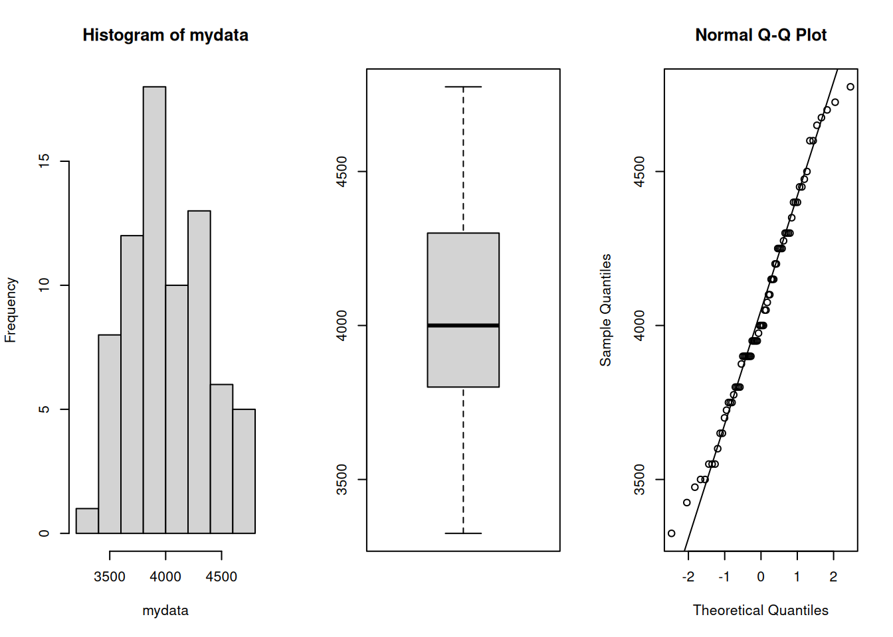

# (PART) Week 7 {-}

# Introduction {#intro_wk7}

Starting this week, the focus of the computer practicals is shifting from learning how to conduct statistical tests with practice exercises and example datasets to analysing the data from your own project. 

However, there is one final test that you might still need to learn how to do - a **two-way ANOVA** - because it could be directly relevant to your project.

Accordingly, I've put together a notebook for week 7 that contains instructions for how to conduct this test in R, along with some tips for how to prepare the plant data that you've collected in the laboratory over the past few weeks. 

I illustrate the method for the two-way ANOVA with the Palmer penguin dataset, which you should be quite familiar with by now. 

You are not expected to complete the test using the penguin data - although you may find it helpful. 


# Two-way ANOVA


A **two-way ANOVA** is used to compare means of a continuous outcome variable which is (potentially) being affected by two different categorical predictor variables at the same time.

For example, we could evaluate the effect of *sex* and *species* on penguin body mass.

One of the key outputs of a two-way ANOVA is what's called an *interactive effect*, which evaluates if each of the categorical factors influences the impact of the other on your outcome variable.

::: {.rmdtip}
***IMPORTANT!***

You can only estimate an *interactive effect* with a two-way ANOVA.

Conducting two separate one-way ANOVAs will only tell you if there is a significant *main effect* of each variable individually, but not if there is a significant interaction.
:::


## Prepare and read in your data

In order to conduct a two-way ANOVA in R, you will need to format your Excel file such that:

1. All of your observations for a given level of measurement (e.g. plant-level vs. leaf-level) are contained within a _single sheet_ that can be exported as a csv file.
2. Each predictor (or independent) variable has its _own column_.
3. Each variable that you may need to filter/subset by has its _own column_.
4. There are _no extra rows or spaces_ - only your column names in row 1 and your data observations in rows 2 through n. 

Depending on how you originally recorded your data in Excel, this may require you to combine observations made in different sheets, and additional columns (e.g. for week).

Once you have formatted your data properly, you can export the sheet(s) as a csv file and upload it (them) to the R server.

Then you can read in your data using the usual method.


``` r
peng_data <- read.csv("data/palmer_penguin_data.csv")
```


## Model notation in R 

Last week you learned about model notation in R and use it to write the model for a linear regression and a one-way ANOVA. You will also need to use it for the two-way ANOVA.

As a reminder:

> In R, the formulas for statistical models are generally written using the `~` symbol (called a "tilde").

> A simple model with soil carbon as the outcome variable and tree density as the predictor variable might look like this: `body_mass ~ species`

> If you were reading the model formula aloud, you would say: "penguin body mass *is predicted by* species"


## Check the model assumptions

Like all statistical tests, a two-way ANOVA assumes that your data are **independent**. (You can ask Doug and/or Ian if they are comfortable with you relaxing that assumption for plants that share a pot.)

Like other parametric tests, a two-way ANOVA assumes that your data - _for each sample/sub-group_ - are **Normally-distributed**. This is more important for smaller datasets (<30 points), but can be ignored for larger datasets.

You should use your `examine_norm()` function that you wrote in week 3, and reused again in weeks 4 and 6 to ensure that your data are Normally distributed.

Although our sample sizes here (from 34 to 73) are large enough that we don't need to check Normality, we'll do it anyway for completeness.


``` r
# Remove NAs
peng_data <- na.omit(peng_data)

# Subset data into subgroups to check Normality
peng_data_male_adelie <- subset(peng_data, sex == "male" & species == "Adelie")
peng_data_female_adelie <- subset(peng_data, sex == "female" & species == "Adelie")
peng_data_male_gentoo <- subset(peng_data, sex == "male" & species == "Gentoo")
peng_data_female_gentoo <- subset(peng_data, sex == "female" & species == "Gentoo")
peng_data_male_chinstrap <- subset(peng_data, sex == "male" & species == "Chinstrap")
peng_data_female_chinstrap <- subset(peng_data, sex == "female" & species == "Chinstrap")
```


``` r
# Check Normality
examine_norm(peng_data_male_adelie$body_mass_g)
```



```
#> 
#> 	Shapiro-Wilk normality test
#> 
#> data:  mydata
#> W = 0.98269, p-value = 0.416
#> Warning in ks.test.default(mydata, "pnorm", mean = mean_md,
#> sd = sd_md): ties should not be present for the one-sample
#> Kolmogorov-Smirnov test
#> 
#> 	Asymptotic one-sample Kolmogorov-Smirnov test
#> 
#> data:  mydata
#> D = 0.084147, p-value = 0.6795
#> alternative hypothesis: two-sided
```

I'm only printing the results for one of the samples (male Adelie penguins) here, but unless your sample sizes are large, you should check all of them. 


## Run the test

To run a two-way ANOVA with an interactive effect in R, the model notation should have a `*` between your two predictor variables (in this case, sex and species), as shown below. 

Just like last week with the one-way ANOVA, you will need to save your model output as an object, and use the `summary()` function to examine it.


``` r
mod <- aov(body_mass_g ~ sex * species, data = peng_data)
summary(mod)
#>              Df    Sum Sq  Mean Sq F value   Pr(>F)    
#> sex           1  38878897 38878897 406.145  < 2e-16 ***
#> species       2 143401584 71700792 749.016  < 2e-16 ***
#> sex:species   2   1676557   838278   8.757 0.000197 ***
#> Residuals   327  31302628    95727                     
#> ---
#> Signif. codes:  
#> 0 '***' 0.001 '**' 0.01 '*' 0.05 '.' 0.1 ' ' 1
```
The output will have four rows of results:

- one for each of the main effects (e.g. `sex` and `species`)
- one for the interaction (`sex:species`)
- one for the residuals ("error" or variation that is not explained in the model)

The four columns should look familiar to you from the one-way ANOVA. They are:

- Df (degrees of freedom)
- sum Sq (sum of squared error)
- Mean Sq (mean squared error)
- F value (the test statistic)
- Pr(>F) (the p-value)

::: {.rmdwarning}
**Warning!**

If the interaction is not significant, then you should rerun the model, without the interaction term.

This is done by changing the `*` to a `+`, as shown below.
:::

Although our interaction for sex and species in the penguin data is highly significant, the code below shows how you would run a two-way ANOVA without an interactive effect.


``` r
mod2 <- aov(body_mass_g ~ sex + species, data = peng_data)
summary(mod2)
#>              Df    Sum Sq  Mean Sq F value Pr(>F)    
#> sex           1  38878897 38878897   387.9 <2e-16 ***
#> species       2 143401584 71700792   715.3 <2e-16 ***
#> Residuals   329  32979185   100241                   
#> ---
#> Signif. codes:  
#> 0 '***' 0.001 '**' 0.01 '*' 0.05 '.' 0.1 ' ' 1
```


## Post-host test

Remember, that an ANOVA only tells you if there is a significant effect between any groups, but not which groups are significantly different to each other.

If your two-way ANOVA is significant, you will need to conduct a post-hoc test to determine which groups are significantly different.

The post-hoc test for a two-way ANOVA is the same one that we used last week for the one-way ANOVA: Tukey's honestly significant difference test, which is done with the function `TukeyHSD()`.


``` r
TukeyHSD(mod)
#>   Tukey multiple comparisons of means
#>     95% family-wise confidence level
#> 
#> Fit: aov(formula = body_mass_g ~ sex * species, data = peng_data)
#> 
#> $sex
#>                 diff      lwr      upr p adj
#> male-female 683.4118 616.7003 750.1233     0
#> 
#> $species
#>                        diff       lwr       upr     p adj
#> Chinstrap-Adelie   26.92385  -80.0258  133.8735 0.8241288
#> Gentoo-Adelie    1377.65816 1287.6926 1467.6237 0.0000000
#> Gentoo-Chinstrap 1350.73431 1239.9964 1461.4722 0.0000000
#> 
#> $`sex:species`
#>                                      diff       lwr
#> male:Adelie-female:Adelie        674.6575  527.8486
#> female:Chinstrap-female:Adelie   158.3703  -25.7874
#> male:Chinstrap-female:Adelie     570.1350  385.9773
#> female:Gentoo-female:Adelie     1310.9058 1154.8934
#> male:Gentoo-female:Adelie       2116.0004 1962.1408
#> female:Chinstrap-male:Adelie    -516.2873 -700.4449
#> male:Chinstrap-male:Adelie      -104.5226 -288.6802
#> female:Gentoo-male:Adelie        636.2482  480.2359
#> male:Gentoo-male:Adelie         1441.3429 1287.4832
#> male:Chinstrap-female:Chinstrap  411.7647  196.6479
#> female:Gentoo-female:Chinstrap  1152.5355  960.9603
#> male:Gentoo-female:Chinstrap    1957.6302 1767.8040
#> female:Gentoo-male:Chinstrap     740.7708  549.1956
#> male:Gentoo-male:Chinstrap      1545.8655 1356.0392
#> male:Gentoo-female:Gentoo        805.0947  642.4300
#>                                       upr     p adj
#> male:Adelie-female:Adelie        821.4664 0.0000000
#> female:Chinstrap-female:Adelie   342.5279 0.1376213
#> male:Chinstrap-female:Adelie     754.2926 0.0000000
#> female:Gentoo-female:Adelie     1466.9181 0.0000000
#> male:Gentoo-female:Adelie       2269.8601 0.0000000
#> female:Chinstrap-male:Adelie    -332.1296 0.0000000
#> male:Chinstrap-male:Adelie        79.6351 0.5812048
#> female:Gentoo-male:Adelie        792.2606 0.0000000
#> male:Gentoo-male:Adelie         1595.2026 0.0000000
#> male:Chinstrap-female:Chinstrap  626.8815 0.0000012
#> female:Gentoo-female:Chinstrap  1344.1107 0.0000000
#> male:Gentoo-female:Chinstrap    2147.4564 0.0000000
#> female:Gentoo-male:Chinstrap     932.3460 0.0000000
#> male:Gentoo-male:Chinstrap      1735.6917 0.0000000
#> male:Gentoo-female:Gentoo        967.7594 0.0000000
```
The Tukey HSD test will provide contrast results for each main effect group and all the subgroups in the interaction.

In this case:

- Both sexes are different
- Gentoo is different to the other two species, but Adelie and Chinstrap are not different to each other
- All of contrasts between specific sex-species subgroups are significantly different to each other except for two (female Chinstrap vs. female Adelie and male Chinstrap vs. male Adelie - this should not be surprising based on the main effect results).
